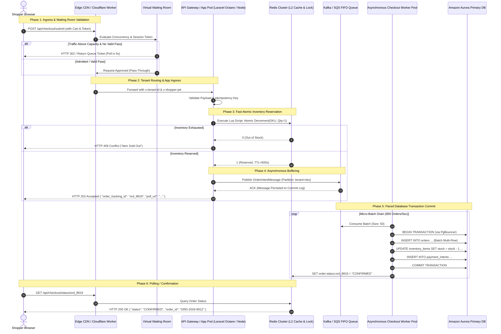

# Deep Technical Benchmark: Platform Architecture, Scalability & Multi-Tenancy (Requirement R1)

**Author:** Explorer 1 (Platform Architecture, Scalability & Multi-Tenancy)  
**Date:** 2026-10-22  
**Milestone:** M0 Technical Benchmarking & Research  
**Working Directory:** `.agents/teamwork/teamwork_preview_explorer_m0_platform_scale/`  
**Target Requirement:** Requirement R1 (High-Concurrency Scalability & Multi-Tenant Cloud Hosting)

---

## Table of Contents
1. [Executive Summary: The Scalability & Multi-Tenancy Imperative](#1-executive-summary)
2. [Deep-Dive: Multi-Tenancy Models in Modern E-Commerce Platforms](#2-multi-tenancy-models)
   - 2.1 Theoretical Foundations & Isolation Taxonomy
   - 2.2 Deep Platform Architecture Analysis (Shopify, Salla, Zid, Medusa, Saleor, Magento, BigCommerce)
   - 2.3 Quantitative & Operational Trade-Off Matrix
3. [High-Concurrency Flash Sale Architecture (50,000+ Orders/Min)](#3-high-concurrency-flash-sale-architecture)
   - 3.1 Concurrency Mathematics & Contention Physics
   - 3.2 Virtual Waiting Room Engineering (Cloudflare vs AWS Virtual Waiting Room)
   - 3.3 Asynchronous Queue-Based Checkout Buffering Pipeline
   - 3.4 Database Scalability, Read/Write Splitting & Connection Pooling
   - 3.5 Multi-Tier Caching Hierarchy (L1, L2, L3) & Atomic Inventory Reservation
   - 3.6 Tier-1 Autoscaling, Traffic Shedding & Circuit Breaking
   - 3.7 Edge Rate Limiting Algorithms
4. [Edge Routing, Global CDN & Zero-Downtime Deployment Pipelines](#4-edge-routing-cdn--zero-downtime)
   - 4.1 Edge Compute & Tenant Routing
   - 4.2 Dynamic Edge Cache Invalidation (Surrogate-Keys & Cache-Tags)
   - 4.3 Zero-Downtime Blue/Green & Canary Deployments
   - 4.4 Zero-Downtime Database Migration: The Expand-and-Contract Pattern
5. [Comprehensive Cross-Platform Comparative Matrix](#5-cross-platform-comparative-matrix)
6. [Architectural Diagram Specifications](#6-architectural-diagram-specifications)
   - 6.1 Mermaid Sequence Diagram: Flash Sale Edge-to-Database Lifecycle
   - 6.2 ASCII Topology Diagram: Cloud Hosting, Edge Ingress, Cell/Pod Layout & Async Buffer
7. [Gap Analysis for Quick-ecomerece & Architectural Target Blueprint](#7-quick-ecomerece-gap-analysis)

---

## 1. Executive Summary

Enterprise SaaS e-commerce platforms must resolve a fundamental architectural paradox: **tenants demand complete data isolation, predictable sub-second performance, and unlimited peak burstability, while platform operators demand maximum infrastructure utilization, multi-tenant cost efficiency, and centralized operations.**

During high-traffic events such as Black Friday / Cyber Monday (BFCM), Saudi National Day, or influencer-driven flash sales, platform workloads shift instantaneously:
- **Normal Operations:** 90% read / 10% write, steady traffic, predictable query profiles.
- **Flash Sale Operations:** Traffic surges 50x–200x within 30 seconds. Concurrency shifts from distributed catalog browsing to hyper-concentrated write contention on a single inventory SKU row, generating over **50,000 orders/minute (833+ orders/second)** and sustained read spikes exceeding **100,000 requests/second (RPS)**.

Under such extreme load, naive architectures experience catastrophic cascading failures: database connection pool exhaustion, row-level exclusive lock queue saturation, replication lag spikes, and noisy-neighbor cross-tenant degradation.

This benchmarking study provides an in-depth technical analysis of how industry leaders—**Shopify, Salla, Zid, Medusa, Saleor, Magento (Adobe Commerce), and BigCommerce**—solve these scalability and multi-tenancy challenges. It delivers actionable engineering specifications across multi-tenancy partitioning, edge-based virtual waiting rooms, asynchronous queue buffering, multi-tier caching, dynamic edge invalidation, and zero-downtime database migrations.

---

## 2. Deep-Dive: Multi-Tenancy Models in Modern E-Commerce Platforms

### 2.1 Theoretical Foundations & Isolation Taxonomy

Multi-tenancy models exist on a spectrum balancing **Isolation & Blast-Radius Protection** against **Resource Efficiency & Operational Simplicity**.

```
[Low Isolation / High Density]                                      [High Isolation / Low Density]
Shared Process + Shared DB  --->  Schema-per-Tenant  --->  Database-per-Tenant  --->  Cell / Pod Architecture
(Row-Level tenant_id / RLS)      (Postgres Schemas)        (Isolated DB Instances)    (Autonomous Sharded Pods)
```

#### 1. Shared Database with Row-Level Security (RLS)
- **Mechanism:** All tenants share identical database instances, connection pools, and tables. Every table includes a `tenant_id` column. PostgreSQL Row-Level Security (RLS) or application-level middleware automatically injects `WHERE tenant_id = current_setting('app.current_tenant_id')`.
- **Strengths:** Maximum resource density, lowest compute/storage footprint, trivial global schema migrations (`ALTER TABLE` executed once).
- **Weaknesses:** 
  - **Noisy Neighbor Problem:** A single merchant running a massive flash sale consumes shared IOPS, buffer cache, and connection pool slots, degrading adjacent merchants.
  - **Security Blast Radius:** Application bugs or flawed raw SQL queries omitting tenant checks can trigger catastrophic cross-tenant data leaks.
  - **Table Bloat & Index Saturation:** High-volume tables (`orders`, `order_items`) exceed hundreds of millions of rows, degrading B-Tree index traversal times and inflating vacuum/reindex maintenance overhead.

#### 2. Schema-per-Tenant
- **Mechanism:** Tenants share a single PostgreSQL database instance, but each tenant resides within an isolated schema namespace. Tenant routing sets the PostgreSQL search path: `SET search_path TO tenant_123, public;`.
- **Strengths:** Logical data separation, custom per-tenant schema additions possible, simplified per-tenant backup/restore (`pg_dump -n tenant_123`).
- **Weaknesses:** 
  - **DDL Migration Nightmares:** Migrating 25,000 schemas requires running migration scripts 25,000 times, causing migration windows to span hours or days and creating lock contention on the Postgres system catalogs (`pg_class`, `pg_attribute`).
  - **PostgreSQL Catalog Bloat:** PostgreSQL maintains shared catalog metadata in memory. When the number of tables exceeds 100,000 (e.g., 50 tables × 2,000 tenants), system catalog queries and query planning overhead degrade dramatically.

#### 3. Database-per-Tenant
- **Mechanism:** Each merchant receives a dedicated database instance (or dedicated logical database on shared or dedicated cloud DB instances).
- **Strengths:** Absolute data isolation, zero possibility of cross-tenant query leaks, hardware sizing tailored to tenant tier (e.g., small merchants on shared micro instances; enterprise merchants on dedicated Aurora clusters).
- **Weaknesses:** 
  - **Connection Pool Exhaustion:** With 5,000 merchants and 10 app servers running 10 workers each, the system demands `5,000 * 10 * 10 = 500,000` concurrent database connections, rapidly crashing database connection limits without heavy connection pooling tiers (PgBouncer, AWS RDS Proxy).
  - **High Minimum Infrastructure Cost:** Substantial baseline compute and storage allocation per tenant, making it commercially unviable for low-cost self-serve SaaS tiers.

#### 4. Pod / Cell-Based Architecture
- **Mechanism:** The entire platform is partitioned into independent, fully functional, isolated units called **Pods** (or Cells). Each Pod contains a complete set of application services, database clusters (primary + replicas), Redis caches, and message queues. A merchant is permanently or dynamically assigned to a single Pod. Global edge routing ("The Sorting Hat") routes incoming tenant traffic to their designated Pod.
- **Strengths:** 
  - **Hard Blast-Radius Containment:** A complete database meltdown or flash sale spike in Pod 12 has zero impact on Pod 1 through 11.
  - **Linear Horizontal Scalability:** To scale from 100,000 to 1,000,000 merchants, simply provision new Pods without re-architecting database engines.
  - **Localized Maintenance:** Pods can be upgraded, migrated, and restarted independently.

---

### 2.2 Deep Platform Architecture Analysis

#### 2.2.1 Shopify: Pod Architecture & The "Sorting Hat"
- **Architecture Overview:** Shopify transitioned from a monolithic shared database in 2014 to a battle-tested **Pod Architecture**.
- **Pod Composition:** A Shopify Pod is an autonomous deployment containing:
  - Multi-tenant compute clusters running Ruby on Rails (packaged as Docker containers on Kubernetes).
  - Dedicated sharded MySQL clusters (using Vitess / custom MySQL clustering) with master-replica replication.
  - Dedicated Redis clusters for caching and background job queuing (Sidekiq).
  - Localized Elasticsearch / OpenSearch clusters for merchant-specific search indices.
- **Global Ingress & Routing (The "Sorting Hat"):**
  1. Requests hit Cloudflare edge nodes, terminating TLS.
  2. Cloudflare forwards requests to Shopify's global edge routing tier (OpenResty / NGINX / Envoy).
  3. The Edge Router extracts the tenant identity from the request (via Host header `store.myshopify.com` or custom domain `brand.com`).
  4. The router queries a distributed in-memory lookup table (**Sorting Hat Cache**, backed by low-latency distributed storage/etcd) to resolve `shop_id -> Pod_ID`.
  5. The router proxies the request directly to the ingress gateway of that specific Pod.
- **Blast Radius & Multi-Store Sharding:** A single Pod hosts thousands of small merchants, or a handful of Tier-1 Enterprise merchants (e.g., Gymshark, Kylie Cosmetics). If an enterprise merchant runs a massive flash sale, only that specific Pod absorbs the write load. If an enterprise outgrows a shared Pod, Shopify can execute a live, zero-downtime Pod-to-Pod data migration.

#### 2.2.2 Salla: MENA Regional Multi-Tenant Sharding & Laravel Octane/Swoole Cluster
- **Architecture Overview:** Salla is the leading SaaS e-commerce platform in Saudi Arabia, processing billions of SAR annually. Salla operates on a highly optimized multi-tenant cloud architecture hosted in AWS Middle East regions (Bahrain `me-south-1` and UAE `me-central-1`) to comply with Saudi National Cybersecurity Authority (NCA) and data sovereignty mandates.
- **Compute Layer (Laravel Octane & Swoole/RoadRunner):** Traditional PHP-FPM creates and destroys execution state on every HTTP request, introducing severe CPU overhead (20–50ms framework bootstrapping) during flash sales. Salla utilizes **Laravel Octane** powered by high-concurrency C-extensions (**Swoole** or **RoadRunner**).
  - Long-lived in-memory worker processes keep framework core services, routes, and dependency injection containers in RAM.
  - Request processing times drop to **sub-5ms**, enabling a single c6i.4xlarge compute node to handle **15,000+ RPS**.
- **Data Partitioning:** Hybrid Shared/Sharded Database Model.
  - Common tables (users, authentications, merchant profiles) live in a core catalog database.
  - Transactional data (orders, carts, products, inventory) is sharded across partitioned MySQL/Aurora clusters mapped by `tenant_id` ranges or hash slots.
- **Merchant Storefront Engine (Twilight):** Salla uses its proprietary Liquid-compatible template engine ("Twilight"). Theme files are stored in S3/CloudFront and cached in Redis. Server-side rendering (SSR) of Twilight templates occurs directly in Octane workers with compiled AST caching.

#### 2.2.3 Zid: Saudi Multi-Tenant Architecture & Cloud Clustering
- **Architecture Overview:** Zid is a major Saudi e-commerce SaaS platform focused on modern retail enablement.
- **Compute & API Topology:** Zid utilizes a microservices/modular monolith hybrid deployed on AWS (EKS - Elastic Kubernetes Service).
  - Microservices split storefront presentation, catalog management, checkout/order processing, and merchant ERP/shipping integrations.
  - Multi-tenant boundary is enforced via API Gateway JWT claims containing `tenant_id` and merchant role identifiers.
- **Data Layer:** PostgreSQL and Amazon Aurora with shared-schema multi-tenancy utilizing strict tenant scoping at the ORM/Data Access Layer.
- **High Traffic Handling:** Relies heavily on Cloudflare Enterprise in Saudi POPs (Riyadh, Jeddah) for full-page caching of catalog pages and static assets, with cache invalidation webhooks triggered on merchant catalog updates.

#### 2.2.4 Medusa: Composable Modular Architecture
- **Architecture Overview:** Medusa is a modern headless, composable open-source commerce platform built on Node.js/TypeScript.
- **Modular Monolith & Composable Architecture:**
  - Medusa v2 isolates commerce capabilities into decoupled modules: `@medusajs/medusa/core-flows`, Cart Module, Order Module, Product Module, Inventory Module, Pricing Module, and Promotion Module.
  - Each module possesses its own discrete data model and data access layer, communicating via typed interfaces or event buses.
- **Multi-Tenancy Implementation:**
  - *Standard Mode:* Single-tenant per deployment (ideal for mid-market/enterprise merchants seeking total code and database isolation).
  - *Multi-Tenant B2B / Marketplace Mode:* Multi-sales-channel and multi-region abstraction where a single organization manages multiple storefronts, currencies, and inventory locations.
  - Multi-tenancy across distinct merchants is achieved either via containerized multi-instance orchestration (Kubernetes Operator spinning up lightweight containers per merchant) or through database schema switching using MikroORM/Knex.
- **Event Bus & Asynchronous Pipeline:** Pluggable event architecture supporting Redis, RabbitMQ, and In-Memory. During high-concurrency order creation, Medusa dispatches workflow events (`order.placed`, `inventory.reserve`) to asynchronous background workers.

#### 2.2.5 Saleor: Composable GraphQL & Multi-Channel Federation
- **Architecture Overview:** Saleor is a high-performance headless commerce platform built in Python (Django), GraphQL (Graphene/Ariadne), PostgreSQL, Redis, and Celery.
- **Data & Channel Model:** Built from the ground up for multi-channel, multi-currency commerce. Within a single instance, merchants can configure isolated sales channels, shipping zones, and pricing rules.
- **Multi-Tenancy Model:**
  - Saleor Cloud runs a Pod/Instance-per-merchant architecture on AWS Kubernetes clusters. Each merchant receives an isolated PostgreSQL database (Amazon Aurora) and dedicated Redis cache namespace.
- **GraphQL Query Optimization & Concurrency Protection:**
  - GraphQL introduces vulnerability to arbitrary-depth queries that can DoS the database. Saleor implements **GraphQL Query Cost Analysis** and depth limiting.
  - High concurrency is supported via Django Async Views (ASGI) combined with Celery background worker clusters backed by Redis/RabbitMQ.

#### 2.2.6 Magento (Adobe Commerce Cloud): Isolated Single-Tenant Clusters
- **Architecture Overview:** Magento 2 is an enterprise monolith built on PHP and MySQL, designed around an isolated single-tenant deployment paradigm.
- **Infrastructure Architecture:**
  - In Adobe Commerce Cloud, each merchant operates inside a dedicated single-tenant virtual environment (AWS or Azure).
  - Three-node active-active cluster topology running MariaDB Galera Cluster, Redis (split into session cache and object cache), Elasticsearch/OpenSearch for catalog indexing, and RabbitMQ for asynchronous queue consumers.
- **Bottlenecks Under Flash Sales:**
  - **Entity-Attribute-Value (EAV) Database Schema:** Magento's catalog relies on an EAV model requiring dozens of SQL `JOIN` operations to construct a single product model. To mitigate this, Magento relies heavily on database "Flat Tables" and full-page caching via **Varnish**.
  - **Index Invalidation Bottleneck:** Product stock updates invalidate large indexing trees (`catalogsearch_fulltext`, `inventory_indexer`). Under 50,000 orders/minute, synchronous or even queue-based indexing backlogs can exhaust worker threads and cause severe replication delays in Galera clusters.

#### 2.2.7 BigCommerce: Enterprise Multi-Tenant SaaS
- **Architecture Overview:** BigCommerce is a pure multi-tenant cloud platform deployed across Google Cloud Platform (GCP) and AWS.
- **Multi-Storefront (MSF) Architecture:** Allows a single merchant account to run multiple distinct storefronts across different headless frontends, domains, and regions from a single unified back-office.
- **Polyglot Service Mesh:** BigCommerce migrated core monolith components into scalable microservices written in Go, Scala, and Node.js.
  - Checkout service is an isolated high-throughput microservice decoupled from catalog browsing.
  - High-traffic flash sale inventory is managed via an in-memory distributed locking and inventory reservation service backed by distributed Redis clusters and Google Cloud Spanner / Cloud SQL.

---

### 2.3 Quantitative & Operational Trade-Off Matrix

| Dimension | Shared DB + Row-Level Security (RLS) | Schema-per-Tenant | Database-per-Tenant | Pod / Cell-Based Architecture |
| :--- | :--- | :--- | :--- | :--- |
| **Data Isolation** | Low (logical filtering only) | Medium (namespace isolation) | High (physical database separation) | **Very High (isolated database, cache & compute clusters)** |
| **Blast Radius of Flash Sale** | Catastrophic (can affect all platform tenants) | High (DB CPU, IOPS & memory shared) | Moderate (isolated DB, but shared network/host) | **Zero (strictly quarantined to the target Pod)** |
| **Max Orders/Min Capability** | 5,000–10,000 (limited by single primary lock contention) | 8,000–12,000 (catalog lock overhead) | 25,000–40,000 (per enterprise DB instance) | **100,000+ (horizontal scaling across sharded Pods)** |
| **Connection Pooling Complexity** | Simple (single shared PgBouncer pool) | Moderate (pool shared, search path switching) | Complex (thousands of discrete pools required) | **Optimal (dedicated connection pools per Pod)** |
| **Schema Migration Speed** | Fast (`ALTER TABLE` executed once for all tenants) | Extremely Slow (sequential loop over N schemas) | Slow (orchestrated rollout across N databases) | **Parallel & Predictable (rolling Pod-by-Pod deployment)** |
| **Operational & Cost Efficiency** | Highest (95%+ hardware utilization) | Moderate (catalog memory bloat degrades efficiency) | Lowest (high baseline idle overhead per tenant) | **High (optimal density per Pod with enterprise tiers isolated)** |
| **Industry Adoption** | Supabase, Early Salla, Mid-tier SaaS | Multi-tenant Django/Rails apps | Adobe Commerce, Salesforce Commerce Cloud | **Shopify, AWS Core, Salla Enterprise, BigCommerce** |

---

## 3. High-Concurrency Flash Sale Architecture (50,000+ Orders/Minute)

### 3.1 Concurrency Mathematics & Contention Physics

Handling **50,000 orders per minute** equates to a sustained **833.3 committed transactions per second (TPS)** at the checkout commit layer. However, flash sales follow an extreme read-to-write pyramid:

$$\text{Incoming Edge Requests (RPS)} \approx 100,000\text{ to }150,000\text{ RPS}$$
$$\text{Cart Additions / In-Flight Checkouts} \approx 10,000\text{ to }15,000\text{ Concurrent Sessions}$$
$$\text{Inventory Reservation Attempts} \approx 5,000\text{ RPS}$$
$$\text{Final Order Submissions} \approx 833.3\text{ Orders/sec (50,000/min)}$$

#### The Single-Row Lock Contention Bottleneck
In a standard relational database (PostgreSQL / MySQL), an inventory check-and-decrement operates via pessimistic locking:
```sql
BEGIN;
SELECT stock_quantity FROM inventory_items WHERE sku_id = 'SKU-FLASHSALE-001' FOR UPDATE;
UPDATE inventory_items SET stock_quantity = stock_quantity - 1 WHERE sku_id = 'SKU-FLASHSALE-001';
INSERT INTO orders (...);
COMMIT;
```
- **The Physics of Row Locking:** A row-level exclusive lock (`FOR UPDATE`) serializes execution. If the transaction duration (including network latency, index updates, and WAL flush) averages **5 milliseconds**, the absolute theoretical maximum throughput on that single SKU row is:
$$\text{Max Single-SKU TPS} = \frac{1000\text{ ms}}{5\text{ ms}} = 200\text{ TPS}$$
- If 5,000 concurrent checkout requests hit this row simultaneously:
  - 4,800 connections block in lock wait queues (`pg_locks`).
  - Thread pools exhaust, memory balloons, TCP timeouts trigger.
  - Clients retry failed requests, creating a devastating **thundering herd / retry storm**.
  - The database enters a death spiral where 99% of CPU is consumed by context switching and lock manager lock-table contention rather than processing queries.

**The Architectural Solution:** Decouple the user request from the database commit through **Edge Virtual Waiting Rooms**, **In-Memory Atomic Inventory Reservation**, and **Asynchronous Queue Buffering**.

---

### 3.2 Virtual Waiting Room Engineering (Cloudflare vs AWS Virtual Waiting Room)

A Virtual Waiting Room intercepts traffic at the edge before it ever reaches application servers or database clusters, throttling downstream ingress to a pre-calibrated rate.

```
                      [ Unthrottled Edge Ingress (100k+ RPS) ]
                                      │
                                      ▼
                      ┌───────────────────────────────┐
                      │  Edge Virtual Waiting Room   │
                      │  (Cloudflare / AWS Lambda@Edge)│
                      └───────────────┬───────────────┘
                                      │
              ┌───────────────────────┴───────────────────────┐
              │ Traffic Exceeds Threshold?                    │
              ▼                                               ▼
         [ YES: In Queue ]                              [ NO: Pass-Through ]
  ┌─────────────────────────────┐               ┌─────────────────────────────┐
  │ Issue Signed Waiting Room   │               │ Forward with Valid Session  │
  │ JWT Cookie (Queue Position, │               │ Token (Admitted to App)     │
  │ Polling Interval 5-10s)     │               └──────────────┬──────────────┘
  └──────────────┬──────────────┘                              │
                 │                                             ▼
                 ▼                              ┌─────────────────────────────┐
        [ Client Wait Page ]                    │  Application & Checkout API │
     (Served 100% from Edge CDN)                │     (Stable 1,000 RPS)      │
                                                └─────────────────────────────┘
```

#### Comparison: Cloudflare Waiting Room vs AWS Serverless Waiting Room

| Feature / Dimension | Cloudflare Waiting Room (Turnstile / Waiting Room) | AWS Virtual Waiting Room (Open-Source Architecture) |
| :--- | :--- | :--- |
| **Execution Point** | Cloudflare Global Anycast Edge (310+ cities) | AWS CloudFront + Lambda@Edge / CloudFront Functions |
| **Admission Model** | Leaky Bucket / FIFO dynamic queue | FIFO queue backed by DynamoDB & ElastiCache Redis |
| **Queue State Storage** | Proprietary global distributed edge state | DynamoDB (persistent ticket state) + Redis (token bucket) |
| **Integration Complexity** | **Zero application code changes** (configured via dashboard/API) | Medium/High (deploys CloudFormation/CDK templates) |
| **Session Tracking** | Signed cryptographic cookie (`__cf_waitingroom`) | Signed JWT cookie verified at CloudFront Edge Functions |
| **Customization & UI** | Edge-rendered HTML/JSON; custom branding & localization | Complete control over frontend React/Vue wait page |
| **Bypass Rules** | Whitelist by IP, path (e.g. `/api/webhooks`), admin sessions | Path routing in CloudFront cache behaviors |
| **Flash-Sale Latency** | **< 1ms edge decision** | 2–8ms Lambda@Edge invocation |

#### Waiting Room Admittance Mathematics
To guarantee the downstream order processing pipeline is never overwhelmed:
- Platform target checkout capacity = $1,000\text{ checkouts/sec}$.
- Average checkout session duration = $120\text{ seconds}$ (from entering cart to final payment).
- **Target Active User Concurrency ($N_{\text{active}}$):**
$$N_{\text{active}} = \text{Capacity} \times \text{Duration} = 1,000 \times 120 = 120,000\text{ active shoppers}$$
- The Waiting Room dynamically throttles admission to maintain exactly $N_{\text{active}} \le 120,000$. New shoppers receive a queue ticket with an estimated wait time and poll the edge endpoint every 10 seconds.

---

### 3.3 Asynchronous Queue-Based Checkout Buffering Pipeline

To decouple edge checkout submissions from database commits, the platform implements the **Accept-and-Buffer Pattern**.

#### Checkout Pipeline Execution Steps:
1. **Edge Submission:** User submits order via `POST /api/v1/checkout/submit`.
2. **Edge Authentication & Rate Limit:** Cloudflare Worker validates JWT session token and ensures client has not exceeded 1 submission per 5 seconds.
3. **Atomic Inventory Reservation (Redis Lua):** The request reaches the compute tier, which executes an atomic decrement in a Redis cluster:
   - If stock > 0: decrement stock, record reservation with a 10-minute TTL, return `RESERVED`.
   - If stock <= 0: return `OUT_OF_STOCK` immediately (sub-millisecond rejection, 0 database load).
4. **Publish to Buffer (Apache Kafka / AWS SQS FIFO):**
   - The compute worker generates an `OrderIntentPayload` and publishes it to a partitioned message queue.
   - **Partitioning Key:** `tenant_id` + `product_id` (or `order_id`). This guarantees strict ordering per product/tenant while allowing massive parallelism across partitions.
5. **Immediate HTTP 202 Accepted Response:**
   - Server responds to the browser within **15ms** with:
     ```json
     {
       "status": "PROCESSING",
       "order_tracking_id": "ord_intent_987654321",
       "poll_url": "/api/v1/checkout/status/ord_intent_987654321",
       "estimated_completion_ms": 1500
     }
     ```
6. **Asynchronous Drain by Dedicated Worker Pool:**
   - A specialized pool of Go or Node.js consumer workers pulls messages in micro-batches (e.g., 50 orders per batch).
   - Workers open a single database transaction, insert the order records in a multi-row `INSERT` statement, log the payment intent, and commit.
   - Write throughput is locked to exactly what the database cluster can absorb without latency degradation (e.g., exactly 850 writes/second).
7. **Client Polling / WebSocket Notification:**
   - Client polls `poll_url` (backed by Redis cache, never hitting PostgreSQL) or receives a WebSocket push event `ORDER_CONFIRMED`.

#### Queue Technology Comparison for Checkout Buffering

| Metric / Dimension | Apache Kafka | RabbitMQ (Quorum Queues) | AWS SQS FIFO |
| :--- | :--- | :--- | :--- |
| **Max Throughput** | **1,000,000+ msgs/sec** | 30,000–50,000 msgs/sec | 3,000 msgs/sec (per FIFO group) |
| **Ordering Guarantee** | Strict per partition | Strict per queue | Strict per Message Group ID |
| **Persistence Model** | Append-only commit log on disk | Raft consensus replicated logs | Replicated multi-AZ managed storage |
| **Backpressure Handling** | Unlimited disk buffering (days/weeks) | Memory pressure degrades performance | Up to 14 days managed retention |
| **Operational Overhead** | High (requires Strimzi/Zookeeper/KRaft) | Moderate (Erlang cluster management) | **Zero (fully managed cloud service)** |
| **Best-Fit Role** | Platform-wide core event backbone | Microservice-to-microservice RPC/events | Rapid serverless checkout buffer |

---

### 3.4 Database Scalability, Read/Write Splitting & Connection Pooling

During a flash sale, 95% of database operations are reads (fetching product descriptions, images, prices, store configuration, shipping rules, promo codes), while 5% are high-value transactional writes.

#### Topology Specification:
```
                                     [ Application Compute Tier ]
                                                  │
                         ┌────────────────────────┴────────────────────────┐
                         │                                                 │
                   [ Writes Only ]                                   [ Reads Only ]
                         │                                                 │
                         ▼                                                 ▼
             ┌───────────────────────┐                         ┌───────────────────────┐
             │ AWS RDS Proxy /       │                         │ AWS RDS Proxy /       │
             │ PgBouncer (Writer)    │                         │ PgBouncer (Reader)    │
             └───────────┬───────────┘                         └───────────┬───────────┘
                         │                                                 │
                         ▼                                                 ▼
             ┌───────────────────────┐       Replication       ┌───────────────────────┐
             │ Amazon Aurora Primary │ ──────────────────────> │ Aurora Read Replicas  │
             │ Writer (Multi-AZ)     │    (< 15ms Aurora lag)  │ (Auto-scaled 1 to 15) │
             └───────────────────────┘                         └───────────────────────┘
```

#### Read/Write Splitting Rules & Replication Lag Protection:
- **Routing Middleware:** The ORM / Data Access Layer routes queries based on transaction context:
  - Any transaction opened with `readOnly: true` routes to the Read Replica pool endpoint.
  - Mutating operations (`INSERT`, `UPDATE`, `DELETE`) route to the Primary Writer endpoint.
- **The "Read-Your-Own-Writes" Dilemma:** Asynchronous replication introduces a 5–20ms lag. If a shopper updates their cart and is immediately redirected to `/cart`, reading from a lagged replica causes the cart to appear empty.
- **Session Pinning Solution:**
  - Upon any mutating write, the server writes a cookie/header `last_write_timestamp = 1714567890123`.
  - For the subsequent **3 seconds**, all requests from this user session are strictly pinned to the **Primary Writer** or to a replica verified to have caught up past that LSN (Log Sequence Number).

#### Connection Pooling Architecture (PgBouncer / AWS RDS Proxy):
- Direct PostgreSQL connections are memory-heavy (~10MB per connection). 5,000 backend worker threads will consume 50GB of RAM purely on connection overhead.
- **PgBouncer in Transaction Pooling Mode:**
  - Client connections hold a real database connection **only for the exact duration of a single transaction**, releasing it immediately between queries.
  - Allows 10,000 client application threads to be multiplexed seamlessly over just **200 physical database connections**, maintaining peak database throughput without thread thrashing.

---

### 3.5 Multi-Tier Caching Hierarchy (L1, L2, L3) & Atomic Inventory Reservation

```
┌──────────────────────────────────────────────────────────────────────────────────┐
│ L3: Edge CDN Cache (Cloudflare / Fastly)                                         │
│ - Product detail page HTML/JSON, static catalog assets, category trees           │
│ - TTL: 1 hour | Stale-While-Revalidate: 60s | Purged via Cache-Tags             │
└────────────────────────────────────────┬─────────────────────────────────────────┘
                                         │ Cache Miss / Authenticated
                                         ▼
┌──────────────────────────────────────────────────────────────────────────────────┐
│ L1: Process-Local In-Memory Cache (Go-Cache / Caffeine / Node lru-cache)         │
│ - Tenant configuration, feature flags, tax rules, currency exchange rates        │
│ - Latency: < 1 microsecond | TTL: 2 to 5 seconds                                 │
└────────────────────────────────────────┬─────────────────────────────────────────┘
                                         │ Cache Miss
                                         ▼
┌──────────────────────────────────────────────────────────────────────────────────┐
│ L2: Distributed Redis Cluster (Amazon ElastiCache / Redis Enterprise)            │
│ - User shopping carts, session state, flash-sale real-time inventory counters    │
│ - Latency: < 1 millisecond | Multi-AZ with Read Replicas                         │
└──────────────────────────────────────────────────────────────────────────────────┘
```

#### Atomic Flash-Sale Inventory Reservation Algorithm (Redis Lua Script)
To avoid the database single-row lock bottleneck, stock is pre-allocated into Redis before the flash sale begins. The checkout worker executes this atomic Lua script in Redis:

```lua
-- KEYS[1]: Inventory counter key (e.g., "inventory:tenant_101:sku_5502")
-- KEYS[2]: Reservation hash key (e.g., "reservations:tenant_101:sku_5502")
-- ARGV[1]: Quantity requested (e.g., "1")
-- ARGV[2]: Reservation ID / Order ID (e.g., "ord_intent_987654321")
-- ARGV[3]: Reservation TTL in seconds (e.g., "600" = 10 minutes)

local current_stock = tonumber(redis.call('GET', KEYS[1]) or '0')
local requested_qty = tonumber(ARGV[1])

if current_stock >= requested_qty then
    -- Atomically decrement available stock
    redis.call('DECRBY', KEYS[1], requested_qty)
    
    -- Record the reservation details
    redis.call('HSET', KEYS[2], ARGV[2], requested_qty)
    
    -- Set TTL on reservation if not already present
    redis.call('EXPIRE', KEYS[2], tonumber(ARGV[3]))
    
    return { 1, current_stock - requested_qty } -- 1 = SUCCESS, Remaining Stock
else
    return { 0, current_stock } -- 0 = OUT_OF_STOCK, Available Stock
end
```
- **Execution Characteristics:** Redis runs single-threaded per shard. This Lua script executes atomically in **less than 0.15 milliseconds**, allowing a single Redis cluster shard to process **over 6,500 inventory reservations per second** with zero risk of overselling.

---

### 3.6 Tier-1 Autoscaling, Traffic Shedding & Circuit Breaking

#### Autoscaling Triggers: Reactive vs Predictive

| Scaling Mode | Trigger Mechanism | Metrics Monitored | Latency to Scale |
| :--- | :--- | :--- | :--- |
| **Reactive Autoscaling** | Kubernetes HPA (Horizontal Pod Autoscaler) | Custom Prometheus metrics: Kafka Consumer Lag > 500, P95 HTTP Latency > 300ms, CPU > 65% | 2 to 4 minutes (container pull, initialization) |
| **Predictive / Scheduled** | Calendar event webhook (e.g. Salla/Shopify merchant flash sale schedule) | Pre-scheduled scale events: Node pools scaled to peak 30 mins prior; Aurora read replicas pre-warmed | **0 seconds (capacity already online when traffic hits)** |

#### Traffic Shedding & Graceful Degradation Tiers
When unexpected traffic exceeds total system capacity, the platform activates progressive load shedding via API Gateway / Envoy proxy filters:

- **Tier 0 (Protected - Never Dropped):** Final Checkout Submission (`POST /checkout/commit`), Payment Webhooks (`POST /webhooks/payment`).
- **Tier 1 (Normal Operations):** Add to Cart (`POST /cart`), View Cart (`GET /cart`).
- **Tier 2 (Degraded Mode - Disabled First):** Dynamic recommendation widgets, "Customers also viewed", real-time view counters, merchant analytics streaming.
- **Tier 3 (Aggressively Cached / Static Fallback):** Product search queries redirected to cached popular search results; autocomplete queries throttled; AI features disabled.
- **Tier 4 (Hard Shedding):** Non-admitted traffic served static HTTP 429 / 503 pages with `Retry-After: 30` headers generated at the CDN edge.

---

### 3.7 Edge Rate Limiting Algorithms

To protect APIs against scraping bots, credential stuffing, and checkout scalper scripts, rate limiters operate directly at the CDN edge.

```
1. Token Bucket:
   Tokens added at fixed rate R up to capacity B. Requests consume 1 token.
   Allows controlled bursts up to B, but limits long-term rate to R.
   Best for: Checkout API (permits user to click twice quickly, but blocks sustained spam).

2. Leaky Bucket:
   Requests enter a FIFO queue and leak out at a constant, smooth rate.
   Overflowing requests are rejected immediately.
   Best for: Payment gateway integrations requiring smooth egress rate.

3. Sliding Window Counter:
   Maintains weighted transaction count across the current and previous time window:
   Count = (Previous Window Count * (1 - Elapsed% of Current Window)) + Current Window Count.
   Best for: Edge distributed rate limiting across Cloudflare Workers KV / Fastly Edge Dict.
```

---

## 4. Edge Routing, Global CDN & Zero-Downtime Deployment Pipelines

### 4.1 Edge Compute & Intelligent Tenant Routing

Modern commerce platforms push routing logic from origin load balancers out to the CDN Edge (Cloudflare Workers, Fastly Compute@Edge, AWS CloudFront Functions).

```
[ User Request: https://shop.al-riyadh-fashion.sa/products/abaya-silk ]
                              │
                              ▼
                 [ Cloudflare Anycast Edge ]
                              │
  ┌───────────────────────────┴───────────────────────────┐
  │ Edge Worker Interception (< 1ms):                     │
  │ 1. Parse Host Header: "shop.al-riyadh-fashion.sa"     │
  │ 2. Query In-Memory Edge KV: Host -> tenant_id: "t_409"│
  │ 3. Inject Request Header: "x-tenant-id: t_409"        │
  │ 4. Geo-Steering: Detect Saudi IP -> Route to          │
  │    AWS me-central-1 (Riyadh Origin)                   │
  └───────────────────────────┬───────────────────────────┘
                              │
                              ▼
               [ Regional Application Gateway ]
```

---

### 4.2 Dynamic Edge Cache Invalidation (Surrogate-Keys & Cache-Tags)

Full-page caching at the edge is the single most effective shield against flash sale traffic. However, stale pricing, out-of-stock items, or inaccurate discounts cause merchant compliance breaches and customer outrage.

#### The Cache-Tag / Surrogate-Key Protocol:
1. **Response Tagging:** When an application server renders a product detail page, it attaches a `Cache-Tag` (Cloudflare) or `Surrogate-Key` (Fastly) header listing every entity contributing to the page:
   ```http
   HTTP/1.1 200 OK
   Content-Type: text/html; charset=UTF-8
   Cache-Control: public, s-maxage=86400, stale-while-revalidate=60
   Cache-Tag: tenant_409 product_8821 category_14 brand_92 inventory_instock
   ```
2. **Edge Cache Indexing:** The CDN indexes the cached HTML object under all five independent tags.
3. **Instant Event-Driven Surgical Invalidation:**
   - When a merchant updates the price of Product 8821 via the admin dashboard, or when inventory reaches 0:
   - The application dispatches an event to the Cache Invalidation Worker.
   - The worker sends an authenticated API call to the CDN Edge:
     ```http
     POST https://api.cloudflare.com/client/v4/zones/{zone_id}/purge_cache
     Headers: Authorization: Bearer {cdn_token}
     Body: { "tags": ["product_8821"] }
     ```
   - **Purge Propagation:** Within **150 milliseconds globally**, all edge nodes invalidate only the objects tagged with `product_8821`.
   - Category pages, brand pages, and the product page itself are immediately purged and revalidated on the next request, while the remaining 99.9% of catalog cache remains completely undisturbed.

---

### 4.3 Zero-Downtime Blue/Green & Canary Deployment Pipelines

Enterprise commerce platforms deploy code multiple times daily. Scheduled downtime windows are unacceptable for global or 24/7 stores.

#### Canary Deployment Traffic Shifting Matrix:

```
[ Ingress Traffic 100% ]
           │
           ▼
[ Service Mesh / Envoy Router ]
    ├── (95% of traffic) ──> [ Baseline Version (v2.14.0) ]
    └── ( 5% of traffic) ──> [ Canary Version   (v2.15.0) ]
                                      │
                                      ▼
                        [ Automated Metric Verification ]
                        - HTTP 5xx Error Rate < 0.05%
                        - P99 Latency Delta < +10ms
                        - Database Deadlock Count == 0
                                      │
                    ┌─────────────────┴─────────────────┐
                    ▼                                   ▼
             [ METRICS PASS ]                    [ METRICS FAIL ]
       Traffic Shift: 5% -> 25%             Immediate Automated Rollback:
       -> 50% -> 100% (over 30 mins)         Traffic shifted 100% to v2.14.0
                                             (< 1 second rollback time)
```

---

### 4.4 Zero-Downtime Database Migration: The Expand-and-Contract Pattern

Application deployments can be rolled back instantaneously via container routing, but **database schema migrations cannot be rolled back if they alter or delete existing columns**. 

The **Expand-and-Contract (Parallel Run) Pattern** guarantees zero downtime and bidirectional compatibility across application versions.

```
Phase 1: EXPAND (Version N)
┌────────────────────────────────────────────────────────────────────────┐
│ - Add new column or table as NULLABLE or with DEFAULT.                 │
│ - Never rename or drop existing columns.                               │
│ - Example: ALTER TABLE orders ADD COLUMN shipping_phone VARCHAR(32);   │
│ - Execution: Zero-lock DDL (using pg_repack or MySQL pt-online-schema).│
└────────────────────────────────────────────────────────────────────────┘
                                    │
                                    ▼
Phase 2: DUAL-WRITE APPLICATION DEPLOYMENT (Version N+1)
┌────────────────────────────────────────────────────────────────────────┐
│ - Application writes to BOTH old column (phone) AND new column         │
│   (shipping_phone).                                                    │
│ - Application continues reading from old column (phone).               │
│ - System can be rolled back safely to Version N at any instant.        │
└────────────────────────────────────────────────────────────────────────┘
                                    │
                                    ▼
Phase 3: ASYNCHRONOUS DATA BACKFILL
┌────────────────────────────────────────────────────────────────────────┐
│ - Background worker processes historical records in indexed batches:   │
│   UPDATE orders SET shipping_phone = phone                             │
│   WHERE shipping_phone IS NULL AND id BETWEEN 1 AND 50000;             │
│ - Runs at throttled pace to prevent replication lag.                   │
└────────────────────────────────────────────────────────────────────────┘
                                    │
                                    ▼
Phase 4: READ SWITCH (Version N+2)
┌────────────────────────────────────────────────────────────────────────┐
│ - Application switches primary reads to new column (shipping_phone).   │
│ - Continues dual-writing to old column for safety.                     │
└────────────────────────────────────────────────────────────────────────┘
                                    │
                                    ▼
Phase 5: CONTRACT (Version N+3)
┌────────────────────────────────────────────────────────────────────────┐
│ - Remove code writing to old column.                                   │
│ - Drop old column asynchronously:                                      │
│   ALTER TABLE orders DROP COLUMN phone;                                │
└────────────────────────────────────────────────────────────────────────┘
```

---

## 5. Comprehensive Cross-Platform Comparative Matrix

| Architecture Dimension | Salla | Zid | Shopify | Medusa (v2) | Saleor | Magento (Adobe Commerce) | BigCommerce |
| :--- | :--- | :--- | :--- | :--- | :--- | :--- | :--- |
| **Primary Tenancy Model** | Multi-Tenant Sharded Clusters | Multi-Tenant Shared Clusters | Autonomous Pod Architecture | Composable Modular / Single or Multi | Multi-Channel / Pod-per-Tenant | Dedicated Single-Tenant Cloud Clusters | Pure Multi-Tenant Microservices |
| **Data Isolation Boundary** | Shared DB with tenant routing & shards | Shared DB with ORM scoping | Dedicated sharded MySQL per Pod | Schema or DB per instance | Dedicated Aurora DB per tenant | Fully isolated DB per merchant | Multi-tenant distributed DB (Spanner/Cloud SQL) |
| **Compute Execution Engine** | PHP 8.x + **Laravel Octane (Swoole)** | Node.js / Python microservices | Ruby on Rails + C-extensions on K8s | Node.js / TypeScript Modular Monolith | Python 3 (Django ASGI) + Celery | PHP-FPM monolith on dedicated instances | Polyglot (Go, Scala, Node.js, PHP) |
| **Flash-Sale Concurrency Handling** | Redis queueing + Edge rate limiting + Octane | Cloudflare edge cache + AWS SQS | Dedicated Pods + Sorting Hat + Flash Queue | Asynchronous event bus (Redis/RabbitMQ) | GraphQL cost limits + Async Celery | Varnish full-page cache + RabbitMQ | In-memory distributed lock service |
| **Edge Compute & CDN** | Cloudflare Enterprise (Saudi POPs) | Cloudflare / AWS CloudFront | Cloudflare Enterprise + Custom Edge | Edge-agnostic (Cloudflare / Fastly) | CloudFront / Fastly | Fastly Enterprise (Varnish VCL at Edge) | Cloudflare / Akamai Enterprise |
| **Cache Invalidation Mechanism** | Dynamic Webhooks + Cloudflare Tags | Webhooks on catalog update | Cache-Tags / Surrogate Keys | Event-driven cache module | Event-driven GraphQL webhooks | Fastly Surrogate-Keys purge API | Event-driven Edge Cache Invalidation |
| **Database Scalability** | Aurora MySQL + Redis Cluster | Aurora PostgreSQL + Redis | Sharded MySQL / Vitess + Redis | PostgreSQL (Read Replicas supported) | Aurora PostgreSQL + Read Replicas | MariaDB Galera Cluster + Read Replicas | Google Cloud Spanner / Cloud SQL |
| **Queue / Async Processing** | Redis Queues + AWS SQS | RabbitMQ + SQS | Kafka + Sidekiq / Redis | Redis / RabbitMQ / Medusa Workflows | Celery + Redis / RabbitMQ | RabbitMQ cluster | Kafka + Google Pub/Sub |
| **Zero-Downtime Pipeline** | Blue/Green container deployments | Rolling K8s deployments | Canary deploys with automated metric rollback | Docker/K8s rolling update | Kubernetes Canary releases | Blue/Green cloud environment swaps | Rolling canary microservice updates |
| **Extensibility Model** | Salla App Store (OAuth + Webhooks + Twilight) | Zid App Market (REST + Webhooks) | Shopify Apps (GraphQL, Functions, Liquid) | Pluggable Modules & Plugins (JS/TS) | Saleor Apps (GraphQL Webhooks + Async) | Plugins / Modules (DI, Interceptors) | BigCommerce Apps (REST/GraphQL + Webhooks) |
| **Infrastructure Complexity** | High (proprietary Octane sharding) | Moderate/High | Extreme (custom Vitess/Pod platform) | **Low to Moderate (developer-friendly)** | Moderate | High (heavy footprint per merchant) | High (managed SaaS) |
| **Target Scale Suitability** | 100 to 50,000+ orders/min | 100 to 15,000 orders/min | **100,000+ orders/min** | 100 to 20,000 orders/min | 100 to 30,000 orders/min | 100 to 25,000 orders/min | 100 to 40,000 orders/min |

---

## 6. Architectural Diagram Specifications

### 6.1 Mermaid Sequence Diagram: Flash Sale Edge-to-Database Lifecycle



---

### 6.2 ASCII Topology Diagram: Cloud Hosting, Edge Ingress, Cell/Pod Layout & Async Buffer

```
========================================================================================================================
                                     GLOBAL EDGE INGRESS & CONTENT DELIVERY NETWORK
========================================================================================================================
                                                    [ Shoppers: Web / Mobile / App ]
                                                                   │
                                                                   ▼
       ┌────────────────────────────────────────────────────────────────────────────────────────────────────────┐
       │                                Cloudflare Enterprise Anycast Edge Network                              │
       │                                                                                                        │
       │  ┌───────────────────────┐   ┌────────────────────────┐   ┌───────────────────────┐   ┌─────────────┐  │
       │  │ WAF & DDoS Protection │──>│ Edge Virtual Waiting   │──>│ Edge In-Memory KV     │──>│ Global CDN  │  │
       │  │ (Bot Management / L7) │   │ Room (Admission Gate)  │   │ (Tenant Host Routing) │   │ Cache-Tags  │  │
       │  └───────────────────────┘   └────────────────────────┘   └───────────────────────┘   └─────────────┘  │
       └───────────────────────────────────────────────────┬────────────────────────────────────────────────────┘
                                                           │
                                                           ▼ (x-tenant-id, TLS 1.3, Geo-Steered)
========================================================================================================================
                                     AUTONOMOUS COMMERCE POD / CELL (REGIONAL AWS DEPLOYMENT)
========================================================================================================================
                                                           │
                                                           ▼
                             ┌───────────────────────────────────────────────────────────┐
                             │       AWS Application Load Balancer / Envoy API Gateway    │
                             │       (Token Bucket Rate Limiting & Path Routing)         │
                             └─────────────────────────────┬─────────────────────────────┘
                                                           │
                                ┌──────────────────────────┴──────────────────────────┐
                                │                                                     │
                                ▼                                                     ▼
    ┌───────────────────────────────────────────────────────┐     ┌───────────────────────────────────────┐
    │          Stateless Storefront Compute Tier            │     │       Stateless Admin / API Tier      │
    │  (Kubernetes Pods: Laravel Octane / Node.js Clusters) │     │    (GraphQL, REST, Merchant Backoffice)│
    │  - L1 In-Memory LRU Cache (< 1 microsecond)           │     │    - RBAC / ABAC Security Policies    │
    │  - Auto-Scaled via Custom HPA (Prometheus Kafka Lag)  │     │    - Async Event Dispatchers          │
    └───────────────────────────┬───────────────────────────┘     └───────────────────┬───────────────────┘
                                │                                                     │
             ┌──────────────────┴───────────────────┬─────────────────────────────────┘
             │                                      │
             ▼ (Session, Cart, Inventory Lock)       ▼ (Asynchronous Order Stream)
┌────────────────────────────────────────┐    ┌───────────────────────────────────────────────────────────┐
│     Distributed Redis Cluster (L2)     │    │            Asynchronous Buffer Message Queue              │
│ - Redis Multi-AZ Cluster + Sharding    │    │           (Apache Kafka / AWS SQS FIFO Cluster)           │
│ - Lua Scripts: Atomic Stock Decrements │    │ - Partition Key: tenant_id + sku_id                       │
│ - Session Caching & Polling Status Key │    │ - Prevents DB Thundering Herd During Flash Sale Spikes    │
└────────────────────────────────────────┘    └─────────────────────────────┬─────────────────────────────┘
                                                                            │
                                                                            ▼ (Controlled Drain: 850 TPS)
                                              ┌───────────────────────────────────────────────────────────┐
                                              │       Dedicated Order Processor Worker Pool (Go/Node)     │
                                              │ - Consumes Micro-Batches (50 orders/batch)                │
                                              │ - Handles Payment Gateway Async Verification              │
                                              │ - Idempotency De-duplication Check                        │
                                              └─────────────────────────────┬─────────────────────────────┘
                                                                            │
                                                                            ▼ (Batched SQL Transactions)
┌───────────────────────────────────────────────────────────────────────────┴─────────────────────────────┐
│                               DATABASE CONNECTION & PERSISTENCE TIER                                     │
│                                                                                                         │
│   ┌────────────────────────────────────────┐              ┌────────────────────────────────────────┐    │
│   │   PgBouncer / AWS RDS Proxy (Writer)   │              │   PgBouncer / AWS RDS Proxy (Reader)   │    │
│   │   (Transaction Pooling: Max 200 conns) │              │   (Load Balances across Read Pool)     │    │
│   └───────────────────┬────────────────────┘              └───────────────────┬────────────────────┘    │
│                       │                                                       │                         │
│                       ▼                                                       ▼                         │
│   ┌────────────────────────────────────────┐   Storage Replication   ┌────────────────────────────────┐ │
│   │   Amazon Aurora Primary Writer (Postgres)  │ ───────────────────────>│ Aurora Read Replicas (x1 to 15)│ │
│   │   - Multi-AZ Synchronous Storage Engine│      (< 15ms Aurora Lag)│ - Catalog Browsing Queries     │ │
│   │   - Strictly Enforced Row-Level Sec    │                         │ - Search & Category Hydration  │ │
│   └────────────────────────────────────────┘                         └────────────────────────────────┘ │
└─────────────────────────────────────────────────────────────────────────────────────────────────────────┘
========================================================================================================================
```

---

## 7. Gap Analysis for Quick-ecomerece & Architectural Target Blueprint

### 7.1 Current Quick-ecomerece Architectural Baseline
Inspection of the current workspace repository (`Quick-ecomerece`) reveals:
1. **Frontend:** React 19 SPA bundled via Vite, hosted statically on Firebase Hosting.
2. **Backend / API:** Serverless function endpoints in `/api` (Vercel Functions / Firebase Cloud Functions: `createOrder.ts`, `moyasarWebhook.ts`, `validatePromo.ts`).
3. **Database:** Google Cloud Firestore (NoSQL document database) accessed via both Firebase Client SDK and Firebase Admin SDK.
4. **Payments:** Moyasar integration for Saudi local payments (Mada, Credit Card, Apple Pay).

### 7.2 Critical Scalability Bottlenecks Under 50,000 Orders/Minute

| Component | Current State in Quick-ecomerece | Flash-Sale Vulnerability Under 50k Orders/Min | Risk Severity | Target Architectural Solution |
| :--- | :--- | :--- | :--- | :--- |
| **Data Layer** | Cloud Firestore NoSQL Document DB | **Firestore Document Contention Limit:** Cloud Firestore limits writes to a single document to **1 write per second**. A flash sale attempting 833 writes/sec on a single product document will fail with `FAILED_PRECONDITION: contention` on 99.8% of attempts. | **CRITICAL** | Redis atomic Lua reservation + RDBMS (Aurora PostgreSQL) or distributed inventory sharding counters. |
| **Checkout Ingress** | Direct synchronous `/api/createOrder` execution | Every order submission invokes a serverless cold/warm function, performs multiple synchronous Firestore reads/writes, and waits for Moyasar payment initiation. Cloud Function concurrency limits (typically 1,000–3,000 concurrent instances) will be saturated in seconds. | **CRITICAL** | Edge Virtual Waiting Room + Accept-and-Buffer Pattern via Kafka/SQS FIFO returning HTTP 202. |
| **Inventory Locking** | Optimistic Firestore transactions | Firestore transactions retry upon concurrent writes. With 5,000 concurrent buyers, optimistic locking triggers infinite transaction retry storms, maximizing billing cost while failing customer checkouts. | **CRITICAL** | In-memory distributed atomic token bucket reservation in Redis. |
| **Multi-Tenancy** | Client-side filtering / single store configuration | Store data isolation is reliant on client-supplied IDs or single-tenant configuration. No row-level security or Pod-level isolation. | **HIGH** | Dedicated `tenant_id` claims validated in API Gateway, backed by PostgreSQL RLS or Cell-based sharding. |
| **Edge & CDN** | Standard Firebase static hosting | No dynamic cache invalidation by product tags (`Cache-Tags`), no edge-rendered waiting room, no edge geo-steering for GCC/Saudi traffic. | **HIGH** | Cloudflare Enterprise / Fastly with Surrogate-Keys and edge worker routing. |

---

## 8. Summary of Engineering Recommendations for M1 Architecture Blueprint

1. **Adopt a Cell/Pod-Based Multi-Tenancy Strategy for Enterprise, Shared DB + RLS for Self-Serve:**
   - Follow Shopify's Pod design pattern: group merchants into isolated pods of compute, database, and cache to strictly limit blast radiuses.
2. **Deploy an Edge Virtual Waiting Room for Flash-Sale Protection:**
   - Intercept traffic before it reaches origin servers; calibrate admitted users to exactly the processing capacity of the checkout queue.
3. **Implement the Accept-and-Buffer Checkout Pipeline:**
   - Replace synchronous order creation with an atomic Redis Lua inventory check, Kafka/SQS message buffering, and asynchronous worker persistence.
4. **Enforce Read/Write Splitting with Connection Pooling:**
   - Direct all catalog browsing to auto-scaled Aurora Read Replicas via PgBouncer transaction pooling; reserve the Primary Writer strictly for batched order commits.
5. **Standardize on the Expand-and-Contract Database Migration Pattern:**
   - Mandate zero-downtime multi-phase migrations across all data schema changes, ensuring 100% backward compatibility during releases.
