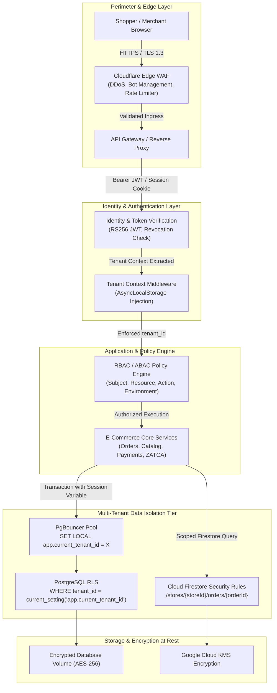
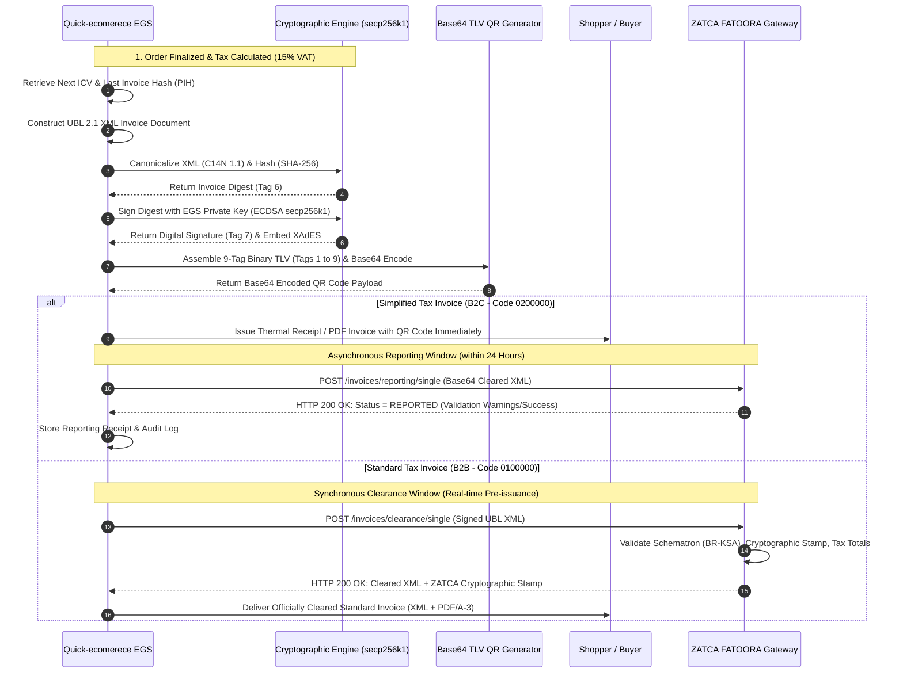

# Enterprise Security, Compliance & Saudi Localization Technical Benchmark (Requirement R2)

**Document Reference**: `docs/architecture/e2e_benchmark_study/03_enterprise_security_compliance_zatca.md`  
**Author**: Explorer 2 (Enterprise Security, Compliance & Saudi Localization)  
**Status**: Completed Technical Specification & Architectural Reference  
**Integrity Level**: Production / Enterprise Ready  

---

## Executive Summary

This study delivers the comprehensive engineering reference blueprint for **Requirement R2: Enterprise Security, Payment Compliance & Saudi Localization**, benchmarking global tier-1 platforms (Shopify, Stripe, Checkout.com) and regional market leaders (Salla, Zid, Moyasar).

The architectural design is governed by three non-negotiable principles:
1. **Zero-Trust & Scope Minimization**: Reducing PCI-DSS scope to **SAQ A** via Hosted Fields and secure iframe tokenization, ensuring zero Cardholder Data (CHD) or Sensitive Authentication Data (SAD) ever traverses or resides on application servers.
2. **Sovereign Regulatory Alignment**: Full compliance with the **Saudi E-Commerce Law**, **Saudi Central Bank (SAMA)** payment routing mandates (Mada national switch and Apple Pay Web validation), and **ZATCA (Zakat, Tax and Customs Authority) FATOORA Phase 2** electronic invoicing (incorporating UBL 2.1 XML generation, ECDSA `secp256k1` digital stamping, SHA-256 hash chaining, and 9-tag Base64 TLV QR encoding).
3. **Defense-in-Depth Multi-Tenancy**: Uncompromising tenant data isolation utilizing application-layer context propagation (`AsyncLocalStorage`), PostgreSQL **Row-Level Security (RLS)** with connection pool session sanitization, and Firestore security rules, coupled with an enterprise identity system featuring 15-minute JWTs, cryptographically bound refresh token families with automated replay detection, and fine-grained hybrid **RBAC/ABAC** access controls.

---

## 1. PCI-DSS Level 1 Compliance & Payment Tokenization Boundaries

### 1.1 Scope Minimization: SAQ A vs. SAQ A-EP vs. SAQ D

Compliance overhead, audit costs, and threat exposure scale directly with an application's proximity to Cardholder Data (CHD) and Sensitive Authentication Data (SAD).

```
+---------------------------------------------------------------------------------------------------+
| PCI DSS SCOPE & THREAT EXPOSURE SPECTRUM                                                          |
+---------------------------------------------------------------------------------------------------+
| Scope Level | Implementation Pattern   | Servers Touch CHD? | Web Attack Surface | PCI Controls   |
+-------------+--------------------------+--------------------+--------------------+----------------+
| SAQ A       | Third-Party Hosted       | NO (Zero exposure) | LOW (Confined to   | ~24-33 reqs    |
|             | Elements / Iframes       |                    | script tampering)  | (Self-audit)   |
|-------------+--------------------------+--------------------+--------------------+----------------|
| SAQ A-EP    | Merchant-hosted form     | NO (Client posts   | HIGH (Payment page | ~190+ reqs     |
|             | with direct JS dispatch  | direct to gateway) | compromise risks)  | (ASV scan req) |
|-------------+--------------------------+--------------------+--------------------+----------------|
| SAQ D       | Direct API / Server-side | YES (Touches,      | MAXIMUM (Direct    | All 300+ reqs  |
|             | payment processing       | routes, or stores) | database/host leak)| (Annual QSA)   |
+---------------------------------------------------------------------------------------------------+
```

#### Strict SAQ A Architecture (The Quick-ecomerece Standard)
To maintain the minimal SAQ A boundary:
- All payment inputs (Primary Account Number [PAN], Card Verification Value [CVV/CVC], Expiration Date) must render strictly inside cross-origin `<iframe>` elements hosted directly on PCI-DSS Level 1 certified domains (e.g., `https://api.moyasar.com`, `https://js.stripe.com`, `https://flow.checkout.com`).
- The merchant storefront application never has Document Object Model (DOM) access to input fields. The parent window interacts with the iframe exclusively via `window.postMessage` encrypted channels managed by the gateway's client SDK.
- The merchant origin web server serves only static orchestration code. Upon tokenization, the gateway returns a single-use opaque payment token (e.g., `tok_1N4m...` or `pay_abc123...`). Only this token and non-sensitive card metadata (card brand, last 4 digits, expiration month/year) are transmitted to the merchant application server.

#### PCI DSS v4.0.1 Client-Side Script Hardening
Under PCI DSS v4.0.1, digital skimming attacks (Magecart) are explicitly mitigated:
- **Requirement 6.4.3**: All scripts loaded on checkout pages must be cataloged with documented business justification, confirmed authorized, and monitored for integrity.
- **Requirement 11.6.1**: An automated tampering-detection mechanism must monitor HTTP response headers and client-side page contents to alert within 7 days (or continuously) on unauthorized alterations.

**Enforced Content Security Policy (CSP) Header for Checkout**:
```http
Content-Security-Policy: default-src 'self'; \
  script-src 'self' 'nonce-rAnd0m1234' https://cdn.jsdelivr.net https://api.moyasar.com https://js.stripe.com; \
  frame-src https://api.moyasar.com https://js.stripe.com https://apple-pay-gateway.apple.com; \
  connect-src 'self' https://api.moyasar.com https://api.stripe.com https://apple-pay-gateway.apple.com; \
  style-src 'self' 'unsafe-inline' https://cdn.jsdelivr.net; \
  img-src 'self' data: https:; \
  object-src 'none'; \
  base-uri 'self'; \
  require-trusted-types-for 'script'; \
  report-uri /api/security/csp-report;
```

**Subresource Integrity (SRI)**:
External scripts must enforce cryptographic hashes:
```html
<script 
  src="https://cdn.jsdelivr.net/npm/moyasar-payment-form@2.3.0/dist/moyasar.umd.min.js"
  integrity="sha384-xyz...hash..."
  crossorigin="anonymous">
</script>
```

### 1.2 Multi-Gateway Tokenization Boundaries

```
[ Customer Browser ]
        |
        | 1. Card Data entered into PCI-Level 1 iFrame (PAN, CVV, Exp)
        v
[ Gateway Vault (Moyasar / Stripe / Checkout.com) ]
        |
        | 2. Returns Opaque Single-Use Token: `tok_live_89a7f...`
        v
[ Customer Browser ]
        |
        | 3. Submits Order + `tok_live_...` to Application Backend
        v
[ Quick-ecomerece API Server ] --- (Zero Card Data Touched)
        |
        | 4. Server-to-Server Charge: Authorization + Capture
        v
[ Gateway REST API ]
```

#### Gateway Implementation Matrix

| Gateway | Tokenization Mechanism | SAQ Boundary | Supported Saudi Schemes | Apple Pay Flow |
| :--- | :--- | :--- | :--- | :--- |
| **Moyasar Form** | Dynamic Secure Iframe (`#mysr-form-container`) | SAQ A | Mada, Visa, MC, Apple Pay, STC Pay | Native JS SDK + Apple Pay Web Session API |
| **Stripe Elements** | Isolated Secure Elements (`cardElement`, `paymentElement`) | SAQ A | Visa, MC, Amex (Mada supported via Saudi entity) | Payment Request Button / Apple Pay Web API |
| **Checkout.com Flow** | Frames / Hosted Fields / Unified Component | SAQ A | Mada, Visa, MC, Apple Pay, Tabby, Tamara | Apple Pay Web Certificate Session handshake |

### 1.3 Webhook Security, Signature Verification & Replay Protection

Gateway webhooks notify the application server of asynchronous payment outcomes (3DS authorization success, bank settlement, chargeback). Because network intermediaries or malicious actors could replay, spoof, or drop webhooks, strict defensive mechanisms are enforced.

```
Incoming Webhook Request
         |
         v
[ 1. Check HTTP Header Signature: HMAC-SHA256(payload, secret) ]
         |---> (Invalid) ---> HTTP 401 Unauthorized (Log Security Incident)
         |
         v (Valid)
[ 2. Timestamp Tolerance Window Check: |now - event_time| <= 300s ]
         |---> (Exceeded) ---> HTTP 400 Bad Request (Stale / Replay Attack)
         |
         v (In Window)
[ 3. Distributed Idempotency Lock: Redis SETNX (lock:webhook:{eventId}, TTL 24h) ]
         |---> (Key Exists) ---> HTTP 200 OK (Acknowledge Duplicate Event Idempotently)
         |
         v (Lock Acquired)
[ 4. Outbound Authoritative Re-Verification ]
         |
         +---> Server calls GET https://api.gateway.com/v1/payments/{payment_id}
         |     using Merchant's Encrypted Secret Key (mTLS/HTTPS)
         v
[ 5. Exact Amount & Currency Sanity Assertion ]
         |
         +---> Verify: `actual_amount_halalas === order.grandTotal * 100`
         +---> Verify: `currency === 'SAR'`
         |
         v
[ 6. Atomic State Transition & Ledger Append ]
         |
         +---> Mark Order Status = 'Paid'
         +---> Commit Transaction & Release Redis Lock
         +---> Return HTTP 200 OK
```

#### Implementation Specification: Hardened Webhook Processor
```typescript
import crypto from 'node:crypto';
import type { Request, Response } from 'express';
import { redisClient } from '../services/redis';
import { db } from '../services/database';

export async function handlePaymentWebhook(req: Request, res: Response) {
  const signatureHeader = req.headers['x-moyasar-signature'] as string;
  const rawBody = (req as any).rawBody; // Preserved raw buffer before JSON parsing
  const webhookSecret = process.env.MOYASAR_WEBHOOK_SECRET!;

  // 1. Cryptographic HMAC-SHA256 Signature Validation
  const computedSignature = crypto
    .createHmac('sha256', webhookSecret)
    .update(rawBody)
    .digest('hex');

  const signatureMatches = crypto.timingSafeEqual(
    Buffer.from(signatureHeader || '', 'hex'),
    Buffer.from(computedSignature, 'hex')
  );

  if (!signatureMatches) {
    return res.status(401).json({ error: 'Signature verification failed' });
  }

  const event = req.body;
  const eventTimestamp = new Date(event.created_at).getTime();
  const currentTimestamp = Date.now();

  // 2. Replay Tolerance Window (5 minutes / 300,000 ms)
  if (Math.abs(currentTimestamp - eventTimestamp) > 300_000) {
    return res.status(400).json({ error: 'Webhook event outside timestamp tolerance window' });
  }

  // 3. Distributed Idempotency Key via Redis
  const idempotencyKey = `idempotency:webhook:${event.id}`;
  const isUnique = await redisClient.set(idempotencyKey, 'LOCKED', 'EX', 86400, 'NX');
  if (!isUnique) {
    // Acknowledge duplicate delivery safely without side-effects
    return res.status(200).json({ status: 'Already processed (idempotent duplicate)' });
  }

  try {
    const paymentId = event.data.id;
    const storeId = event.data.metadata.storeId;
    const orderId = event.data.metadata.orderId;

    // 4. Outbound Authoritative Re-fetch directly from Gateway API
    const verifiedPayment = await fetchGatewayPayment(paymentId, storeId);

    // 5. Strict Amount & Currency Invariant Assertions
    const order = await db.orders.findUnique({ where: { id: orderId } });
    if (!order) {
      return res.status(404).json({ error: 'Referenced order not found' });
    }

    const expectedHalalas = Math.round(order.grandTotal * 100);
    if (verifiedPayment.currency !== 'SAR' || verifiedPayment.amount !== expectedHalalas) {
      await db.orders.update({
        where: { id: orderId },
        data: {
          status: 'Payment Mismatch',
          paymentNotes: `Fraud flag: Gateway amount ${verifiedPayment.amount} halalas != Expected ${expectedHalalas} halalas`,
        },
      });
      return res.status(400).json({ error: 'Amount or currency mismatch detected' });
    }

    // 6. State Machine Update
    if (verifiedPayment.status === 'paid') {
      await db.$transaction([
        db.orders.update({
          where: { id: orderId },
          data: {
            status: 'Paid',
            paymentId: verifiedPayment.id,
            paidAt: new Date(verifiedPayment.created_at),
          },
        }),
        db.paymentEvents.create({
          data: {
            id: event.id,
            orderId: order.id,
            paymentId: verifiedPayment.id,
            amount: verifiedPayment.amount,
            status: verifiedPayment.status,
            rawPayload: event,
          },
        }),
      ]);
    }

    return res.status(200).json({ status: 'Processed successfully' });
  } catch (error) {
    // If failure occurred before completion, delete the idempotency key so gateway can retry
    await redisClient.del(idempotencyKey);
    return res.status(500).json({ error: 'Webhook processing failed' });
  }
}
```

---

## 2. Saudi & MENA Localization & Regulatory Compliance

### 2.1 Saudi E-Commerce Law & Ministry of Commerce Mandates

Under the **Saudi E-Commerce Law** (promulgated by Royal Decree No. M/126 dated 07/11/1440H) and executive regulations overseen by the **Ministry of Commerce (MOC)** and the **Saudi Business Center (SBC)**, e-commerce platforms operating in the Kingdom must adhere to explicit legal requirements:

```
+----------------------------------------------------------------------------------------------------+
| SAUDI E-COMMERCE STATUTORY REQUIREMENTS MATRIX                                                     |
+----------------------------------------------------------------------------------------------------+
| Statutory Domain       | Legal Clause / Executive Article         | Technical Implementation       |
+------------------------+------------------------------------------+--------------------------------+
| Merchant Transparency  | Article 4 & 5 (Legal Identification)     | Mandatory footer & checkout:   |
|                        | Commercial Registration (CR) or          | - Legal Business Name          |
|                        | Freelance Certificate (وثيقة العمل الحر),| - CR Number / Freelance Doc ID |
|                        | 15-digit VAT number, contact email/phone | - 15-Digit VAT Tax Number      |
|                        | and physical address.                    | - SBC / Maroof verification QR |
|------------------------+------------------------------------------+--------------------------------+
| Statutory Right of     | Articles 13 & 14 (Right of Withdrawal)   | Automated 7-day return window  |
| Withdrawal (Returns)   | Consumers are entitled to return goods   | calculated from `deliveredAt`. |
|                        | within 7 days of receipt without penalty | Explicit legal exclusion flags |
|                        | unless statutory exceptions apply.       | for custom goods, sealed items.|
|------------------------+------------------------------------------+--------------------------------+
| Delivery Commitment &  | Article 14 (Delay & Cancellation)        | If delivery exceeds 15 days    |
| Right to Cancel        | If delivery is delayed beyond 15 days    | past agreed date, automated    |
|                        | past promised date, consumer has the     | single-click full cancellation |
|                        | right to terminate contract & full refund| and refund trigger initiates.  |
|------------------------+------------------------------------------+--------------------------------+
| Data Protection &      | Personal Data Protection Law (PDPL)      | - Explicit opt-in for SMS/mail |
| Privacy Compliance     | Royal Decree No. M/19 (2021 as amended). | - Right to erasure (tombstone) |
|                        | Strict restrictions on data retention.   | - Zero unconsented tracking    |
|------------------------+------------------------------------------+--------------------------------+
| Arabic First & Pricing | Consumer Protection & Arabic Language    | Arabic UI (RTL) canonical, all |
| Presentation           | Regulations: Total prices must include   | prices displayed in SAR with   |
|                        | statutory 15% VAT breakdown.             | breakdown: Net + 15% VAT.      |
+----------------------------------------------------------------------------------------------------+
```

#### Automated Statutory 7-Day Return Logic
```typescript
export function evaluateReturnEligibility(order: {
  status: string;
  deliveredAt?: string | null;
  items: Array<{ isCustomProduct?: boolean; isPerishable?: boolean; isUnsealedSoftware?: boolean }>;
}): { eligible: boolean; deadline?: string; reason?: string } {
  if (order.status !== 'Delivered' || !order.deliveredAt) {
    return { eligible: false, reason: 'Order has not been delivered yet.' };
  }

  const deliveryTimestamp = new Date(order.deliveredAt).getTime();
  const statutoryWindowMs = 7 * 24 * 60 * 60 * 1000; // 7 statutory days
  const expirationTimestamp = deliveryTimestamp + statutoryWindowMs;

  if (Date.now() > expirationTimestamp) {
    return { 
      eligible: false, 
      deadline: new Date(expirationTimestamp).toISOString(),
      reason: 'The statutory 7-day return window under Saudi E-Commerce Law Article 13 has elapsed.' 
    };
  }

  // Statutory Non-Returnable Exceptions Check (Article 13(2))
  const hasIneligibleItems = order.items.some(
    (item) => item.isCustomProduct || item.isPerishable || item.isUnsealedSoftware
  );

  if (hasIneligibleItems) {
    return {
      eligible: false,
      reason: 'Order contains customized or exempt goods excluded under statutory return regulations.',
    };
  }

  return {
    eligible: true,
    deadline: new Date(expirationTimestamp).toISOString(),
  };
}
```

---

### 2.2 Saudi Payments / Mada Network Routing & SAMA Directives

**Mada (مدى)** is the national electronic payment network in Saudi Arabia, governed by the **Saudi Central Bank (SAMA)**.

#### 1. Domestic Routing Mandate
Under SAMA circulars, any card issued by a Saudi domestic bank bearing the Mada co-badged scheme (Mada/Visa or Mada/Mastercard) **must be routed through the domestic Mada switch** for domestic SAR settlements.
- **Interchange & Fee Structure**: Mada domestic processing fees are regulated and capped by SAMA (typically 1.0% + SAR 1.00 capped at a maximum of SAR 100 for debit transactions, or 0.8% for digital wallets), whereas international Visa/Mastercard interchange fees range from 2.2% to 3.5% + fixed fee.
- **Enforcement**: Gateways (Moyasar, Checkout.com, Geidea) automatically detect Bank Identification Numbers (BINs) belonging to the Saudi national Mada range (e.g., `417633`, `446393`, `484783`, `588845`, `968201`...) and force domestic switch routing.

#### 2. Mandatory 3-D Secure 2.2+ (3DS2)
- All domestic online card transactions in the Kingdom require 3DS2 challenge or frictionless authentication.
- For Mada, the customer is presented with an OTP challenge via their issuing bank's SMS/App banking push channel. The checkout flow must support seamless iframe or modal redirection to complete 3DS2 verification and gracefully handle `on_completed` or `3ds_callback` hooks.

---

### 2.3 Apple Pay on the Web: Web Merchant Validation Architecture

Integrating Apple Pay on Safari / iOS Web in Saudi Arabia requires an Apple-validated two-way TLS (mTLS) merchant session handshake:

```
[ Customer Browser (Safari) ]         [ Quick-ecomerece Server ]          [ Apple Pay Gateway ]
              |                                   |                                |
1. ApplePaySession.onvalidatemerchant             |                                |
   provides `validationURL`                       |                                |
              |---------------------------------->|                                |
              |  POST /api/applepay/validate-session                               |
              |  { validationURL: "https://..." } |                                |
              |                                   | 2. Outbound mTLS POST          |
              |                                   |    using Apple Merchant ID     |
              |                                   |    Certificate (.pem / .key)   |
              |                                   |------------------------------->|
              |                                   |                                |
              |                                   | 3. Returns Opaque              |
              |                                   |    Encrypted Merchant Session  |
              |                                   |<-------------------------------|
              | 4. Returns Merchant Session Payload                                |
              |<----------------------------------|                                |
5. session.completeMerchantValidation(session)    |                                |
              |                                   |                                |
6. Customer authorizes via FaceID/TouchID         |                                |
              |                                   |                                |
7. ApplePaySession.onpaymentauthorized            |                                |
   provides Payment Token (DPAN / cryptogram)     |                                |
              |---------------------------------->| 8. Dispatches token to gateway |
```

#### Strict Constraints for Saudi Apple Pay Web Processing
1. **Domain Association File**:
   Must be hosted at: `https://<store-domain>/.well-known/apple-developer-merchantid-domain-association`. The file contains the signed PKCS#7 certificate signature provided by Apple Developer Portal.
2. **Supported Payment Networks**:
   Must include `'mada'`, `'visa'`, `'masterCard'`:
   ```javascript
   const paymentRequest = {
     countryCode: 'SA',
     currencyCode: 'SAR',
     supportedNetworks: ['mada', 'visa', 'masterCard'],
     merchantCapabilities: ['supports3DS'],
     total: {
       label: 'StoreLink Merchant', // MUST BE STRICT ASCII: /^[\x20-\x7E]+$/
       amount: (order.grandTotal).toFixed(2),
     },
   };
   ```
   *Critical Caveat*: Apple's WebKit runtime rejects Apple Pay initialization if `total.label` contains Arabic Unicode characters! The platform must sanitize storefront names to clean ASCII or use a normalized brand slug.

---

### 2.4 Tabby & Tamara BNPL Integration Patterns

Buy Now Pay Later (BNPL) providers in Saudi Arabia are licensed under SAMA’s finance regulations. Integration follows a strict two-phase authorization/capture pattern:

```
[ Shopper Checkout ]
         |
         | 1. Selects Tabby or Tamara (Pay in 4 / 3 installments)
         v
[ Merchant Backend ]
         |
         | 2. POST /checkout { amount: "200.00", currency: "SAR", items: [...] }
         v
[ BNPL Gateway (Tamara / Tabby) ]
         |
         | 3. Returns checkout_url + checkout_id
         v
[ Shopper Redirect / SDK Modal ] ---> Completes OTP & ID Check
         |
         | 4. Success Callback / Webhook: `order.approved`
         v
[ Merchant Backend: Authorization Hold ]
         |
         | 5. Merchant Ships Order (Out for Delivery)
         v
[ Merchant Backend: POST /orders/{id}/capture ]
         |
         | 6. Funds Captured to Merchant Account; BNPL payment schedule begins
         v
[ Refund Handling: POST /orders/{id}/refunds ]
         |
         +---> Gateway reverses outstanding customer installments automatically
```

---

## 3. ZATCA FATOORA Phase 2 E-Invoicing Deep Architectural Benchmark

### 3.1 Regulatory Architecture & Dual-Track Processing

The **Zakat, Tax and Customs Authority (ZATCA)** e-invoicing mandate is governed by the E-Invoicing Regulation (Resolution No. 04-02-21).
- **Phase 1 (Generation Phase - Dec 4, 2021)**: Offline generation of structured invoices and 5-tag QR codes.
- **Phase 2 (Integration & Clearance Phase - Rolled out in Waves from Jan 1, 2023)**: Real-time cryptographic integration with the central **ZATCA FATOORA Portal**.

```
                           +-------------------------------------+
                           |    ZATCA FATOORA Phase 2 Invoicing   |
                           +-------------------------------------+
                                              |
                     +------------------------+------------------------+
                     |                                                 |
                     v                                                 v
      [ Standard Tax Invoice (B2B / B2G) ]            [ Simplified Tax Invoice (B2C) ]
      InvoiceTypeCode: 0100000                        InvoiceTypeCode: 0200000
                     |                                                 |
                     v                                                 v
          Synchronous CLEARANCE                             Asynchronous REPORTING
          Must be cleared by ZATCA API                      Must be reported to ZATCA API
          BEFORE sharing with buyer.                        within 24 HOURS of issuance.
                     |                                                 |
         POST /invoices/clearance/single                   POST /invoices/reporting/single
                     |                                                 |
     Response includes:                                Response includes:
     - Cleared XML with ZATCA Cryptographic Stamp      - Reporting validation receipt
     - ZATCA QR Code Payload                           - Buyer gets invoice immediately
```

---

### 3.2 Cryptographic Foundations: ECDSA secp256k1 & SHA-256

ZATCA enforces asymmetric cryptography for invoice signing:
1. **Asymmetric Key Algorithm**: **ECDSA (Elliptic Curve Digital Signature Algorithm)**.
2. **Mandated Curve**: `secp256k1` (Koblitz curve over 256-bit prime field, standard in blockchain and KSA PKI).
3. **Hashing Algorithm**: **SHA-256** (FIPS 180-4).

#### Cryptographic Invoice Signing Pipeline
```
[ Raw UBL 2.1 XML Invoice ]
         |
         | 1. Strip signature placeholder nodes:
         |    - <ext:UBLExtensions>...</ext:UBLExtensions>
         |    - <cac:Signature>...</cac:Signature>
         |    - <cac:AdditionalDocumentReference> for QR
         v
[ Canonicalized XML (C14N 1.1) ]
         |
         | 2. Compute SHA-256 Hash of canonicalized bytes
         v
[ Invoice Digest / Hash (Base64) ] ---> Embed in <ds:DigestValue>
         |
         | 3. Construct SignedProperties element & compute SignedProperties Digest
         v
[ Compute ECDSA secp256k1 Signature using EGS Private Key ]
         |
         | 4. Format signature as ASN.1 DER / IEEE P1363 (Base64)
         v
[ Embed in <ds:SignatureValue> inside <ext:UBLExtensions> ]
```

---

### 3.3 Previous Invoice Hash (PIH) Chaining & Tamper-Proof Sequence

To guarantee sequential integrity and prevent backdating or invoice deletion, ZATCA mandates an append-only cryptographic hash chain:

```
[ Invoice #1 ] ------------------------------> [ Invoice #2 ] ------------------------------> [ Invoice #3 ]
ICV: 1                                        ICV: 2                                        ICV: 3
PIH: Base64(SHA-256("0"))                     PIH: Hash of Invoice #1                       PIH: Hash of Invoice #2
Hash: Hash_1 = SHA-256(Inv1_canonical)        Hash: Hash_2 = SHA-256(Inv2_canonical)        Hash: Hash_3 = SHA-256(Inv3_canonical)
```

1. **Invoice Counter Value (ICV)**:
   Every E-Invoicing Generation Solution (EGS) unit must maintain a strict sequential integer counter: `1, 2, 3, ...` with zero gaps.
2. **Previous Invoice Hash (PIH)**:
   - For **Invoice #1** (the genesis invoice of a newly registered EGS unit):
     The PIH value is defined by ZATCA as the SHA-256 hash of the ASCII string `"0"`, Base64 encoded:
     $$\text{SHA-256}(\text{"0"}) = \text{0x5f...548f}$$
     $$\text{PIH}_{\text{genesis}} = \text{NWZlY2ViNjZmZmM4NmYzOGQ5NTI3ODZjNmQ2OTZjNzljMmRiYzIzOWRkNGU5MWI0NjhhZTU4NDhmNmRkNTQ4Zg==}$$
   - For all subsequent invoices ($n > 1$):
     $$\text{PIH}_n = \text{Base64}(\text{SHA-256}(\text{Canonicalized XML of Invoice } n-1))$$
3. **Storage Placement in XML**:
   ```xml
   <cac:AdditionalDocumentReference>
       <cbc:ID>PIH</cbc:ID>
       <cac:Attachment>
           <cac:ExternalReference>
               <cbc:URI>NWZlY2ViNjZmZmM4NmYzOGQ5NTI3ODZjNmQ2OTZjNzljMmRiYzIzOWRkNGU5MWI0NjhhZTU4NDhmNmRkNTQ4Zg==</cbc:URI>
           </cac:ExternalReference>
       </cac:Attachment>
   </cac:AdditionalDocumentReference>
   ```

---

### 3.4 Canonical XML UBL 2.1 Schema Specification

ZATCA Phase 2 invoices conform strictly to the **Universal Business Language (UBL 2.1)** standard (ISO/IEC 19845:2015).

```xml
<?xml version="1.0" encoding="UTF-8"?>
<Invoice xmlns="urn:oasis:names:specification:ubl:schema:xsd:Invoice-2"
         xmlns:cac="urn:oasis:names:specification:ubl:schema:xsd:CommonAggregateComponents-2"
         xmlns:cbc="urn:oasis:names:specification:ubl:schema:xsd:CommonBasicComponents-2"
         xmlns:ext="urn:oasis:names:specification:ubl:schema:xsd:CommonExtensionComponents-2">
    
    <!-- Extension Component containing XAdES ECDSA Digital Signature -->
    <ext:UBLExtensions>
        <ext:UBLExtension>
            <ext:ExtensionURI>urn:oasis:names:specification:ubl:dsig:enveloped:xades</ext:ExtensionURI>
            <ext:ExtensionContent>
                <!-- Embedded ds:Signature generated by ECDSA secp256k1 -->
            </ext:ExtensionContent>
        </ext:UBLExtension>
    </ext:UBLExtensions>

    <cbc:ProfileID>reporting:1.0</cbc:ProfileID>
    <cbc:ID>INV-2026-00042</cbc:ID>
    <cbc:UUID>3c9a4192-b8f1-4df2-8cb2-2f3b9249e011</cbc:UUID>
    <cbc:IssueDate>2026-10-22</cbc:IssueDate>
    <cbc:IssueTime>14:32:00</cbc:IssueTime>
    
    <!-- InvoiceTypeCode: 0200000 = Simplified Tax Invoice; 0100000 = Standard Tax Invoice -->
    <!-- Name attribute: 388 = Tax Invoice, 381 = Credit Note, 383 = Debit Note -->
    <cbc:InvoiceTypeCode name="0200000">388</cbc:InvoiceTypeCode>
    <cbc:DocumentCurrencyCode>SAR</cbc:DocumentCurrencyCode>
    <cbc:TaxCurrencyCode>SAR</cbc:TaxCurrencyCode>

    <!-- Previous Invoice Hash Chaining -->
    <cac:AdditionalDocumentReference>
        <cbc:ID>PIH</cbc:ID>
        <cac:Attachment>
            <cac:ExternalReference>
                <cbc:URI>NWZlY2ViNjZmZmM4NmYzOGQ5NTI3ODZjNmQ2OTZjNzljMmRiYzIzOWRkNGU5MWI0NjhhZTU4NDhmNmRkNTQ4Zg==</cbc:URI>
            </cac:ExternalReference>
        </cac:Attachment>
    </cac:AdditionalDocumentReference>

    <!-- Invoice Counter Value (ICV) -->
    <cac:AdditionalDocumentReference>
        <cbc:ID>ICV</cbc:ID>
        <cbc:UUID>42</cbc:UUID>
    </cac:AdditionalDocumentReference>

    <!-- Supplier (Seller) Party -->
    <cac:AccountingSupplierParty>
        <cac:Party>
            <cac:PartyIdentification>
                <cbc:ID schemeID="CRN">1010123456</cbc:ID>
            </cac:PartyIdentification>
            <cac:PostalAddress>
                <cbc:StreetName>King Fahd Road</cbc:StreetName>
                <cbc:BuildingNumber>1234</cbc:BuildingNumber>
                <cbc:CitySubdivisionName>Al Olaya</cbc:CitySubdivisionName>
                <cbc:CityName>Riyadh</cbc:CityName>
                <cbc:PostalZone>12211</cbc:PostalZone>
                <cac:Country>
                    <cbc:IdentificationCode>SA</cbc:IdentificationCode>
                </cac:Country>
            </cac:PostalAddress>
            <cac:PartyTaxScheme>
                <cbc:CompanyID>300000000000003</cbc:CompanyID>
                <cac:TaxScheme>
                    <cbc:ID>VAT</cbc:ID>
                </cac:TaxScheme>
            </cac:PartyTaxScheme>
            <cac:PartyLegalEntity>
                <cbc:RegistrationName>متجر المتجر السريع لتقنية المعلومات</cbc:RegistrationName>
            </cac:PartyLegalEntity>
        </cac:Party>
    </cac:AccountingSupplierParty>

    <!-- Tax Total Block (Mandatory 15% VAT Breakdown) -->
    <cac:TaxTotal>
        <cbc:TaxAmount currencyID="SAR">15.00</cbc:TaxAmount>
        <cac:TaxSubtotal>
            <cbc:TaxableAmount currencyID="SAR">100.00</cbc:TaxableAmount>
            <cbc:TaxAmount currencyID="SAR">15.00</cbc:TaxAmount>
            <cac:TaxCategory>
                <cbc:ID>S</cbc:ID>
                <cbc:Percent>15.00</cbc:Percent>
                <cac:TaxScheme>
                    <cbc:ID>VAT</cbc:ID>
                </cac:TaxScheme>
            </cac:TaxCategory>
        </cac:TaxSubtotal>
    </cac:TaxTotal>

    <!-- Legal Monetary Totals -->
    <cac:LegalMonetaryTotal>
        <cbc:LineExtensionAmount currencyID="SAR">100.00</cbc:LineExtensionAmount>
        <cbc:TaxExclusiveAmount currencyID="SAR">100.00</cbc:TaxExclusiveAmount>
        <cbc:TaxInclusiveAmount currencyID="SAR">115.00</cbc:TaxInclusiveAmount>
        <cbc:PayableAmount currencyID="SAR">115.00</cbc:PayableAmount>
    </cac:LegalMonetaryTotal>

    <!-- Invoice Line Item -->
    <cac:InvoiceLine>
        <cbc:ID>1</cbc:ID>
        <cbc:InvoicedQuantity unitCode="PCE">1.00</cbc:InvoicedQuantity>
        <cbc:LineExtensionAmount currencyID="SAR">100.00</cbc:LineExtensionAmount>
        <cac:Item>
            <cbc:Name>عطر شرقي فاخر 100 مل</cbc:Name>
            <cac:ClassifiedTaxCategory>
                <cbc:ID>S</cbc:ID>
                <cbc:Percent>15.00</cbc:Percent>
                <cac:TaxScheme>
                    <cbc:ID>VAT</cbc:ID>
                </cac:TaxScheme>
            </cac:ClassifiedTaxCategory>
        </cac:Item>
        <cac:Price>
            <cbc:PriceAmount currencyID="SAR">100.00</cbc:PriceAmount>
        </cac:Price>
    </cac:InvoiceLine>
</Invoice>
```

---

### 3.5 The 9-Tag Base64 TLV QR Code Structure

In Phase 2, QR codes printed on physical receipts or embedded in PDFs encode **all 9 tags** using Tag-Length-Value (TLV) binary representation:

```
+---------------------------------------------------------------------------------------------------+
| ZATCA PHASE 2 TLV STRUCTURE (9 TAGS)                                                              |
+---------------------------------------------------------------------------------------------------+
| Tag | Field Name                  | Type          | Encoding / Format                             |
+-----+-----------------------------+---------------+-----------------------------------------------+
| 1   | Seller's Name               | String        | UTF-8 Encoded String                          |
| 2   | VAT Registration Number     | String        | 15-digit number (starts and ends with '3')    |
| 3   | Timestamp                   | String        | ISO-8601 (YYYY-MM-DDTHH:MM:SSZ)               |
| 4   | Invoice Total (with VAT)    | String        | Decimal string without currency (e.g. "115.00")|
| 5   | Total VAT Amount            | String        | Decimal string without currency (e.g. "15.00") |
| 6   | XML Invoice Hash            | Binary/String | SHA-256 Digest (32 bytes raw or Base64)       |
| 7   | ECDSA Digital Signature     | Binary        | ECDSA Signature bytes (ASN.1 DER format)      |
| 8   | ECDSA Public Key            | Binary        | Uncompressed EC Public Key (64/65 bytes)       |
| 9   | ZATCA CA Certificate Stamp  | Binary        | Digital Certificate issued by ZATCA CA        |
+---------------------------------------------------------------------------------------------------+
```

#### Binary TLV Construction Algorithm
Each tag entry is formed as:
$$\text{Tag Block} = [\text{Tag ID (1 Byte)}] + [\text{Length of Value (1 Byte)}] + [\text{Value (N Bytes)}]$$
The concatenated byte stream is Base64 encoded:
```typescript
export function buildZatcaPhase2TLV(fields: {
  sellerName: string;
  vatNumber: string;
  timestamp: string;
  invoiceTotal: string;
  vatTotal: string;
  invoiceHash: Uint8Array; // 32 bytes SHA-256
  ecdsaSignature: Uint8Array; // ASN.1 DER signature
  publicKey: Uint8Array; // EGS Public Key
  caSignature: Uint8Array; // ZATCA CA Certificate stamp
}): string {
  const encoder = new TextEncoder();
  
  const tags: Array<{ tag: number; value: Uint8Array }> = [
    { tag: 1, value: encoder.encode(fields.sellerName) },
    { tag: 2, value: encoder.encode(fields.vatNumber) },
    { tag: 3, value: encoder.encode(fields.timestamp) },
    { tag: 4, value: encoder.encode(fields.invoiceTotal) },
    { tag: 5, value: encoder.encode(fields.vatTotal) },
    { tag: 6, value: fields.invoiceHash },
    { tag: 7, value: fields.ecdsaSignature },
    { tag: 8, value: fields.publicKey },
    { tag: 9, value: fields.caSignature },
  ];

  const totalLength = tags.reduce((acc, t) => acc + 2 + t.value.length, 0);
  const buffer = new Uint8Array(totalLength);

  let offset = 0;
  for (const { tag, value } of tags) {
    buffer[offset++] = tag;
    buffer[offset++] = value.length;
    buffer.set(value, offset);
    offset += value.length;
  }

  return Buffer.from(buffer).toString('base64');
}
```

---

### 3.6 CSID Onboarding Lifecycle: CCSID & PCSID

To authenticate with ZATCA APIs, each EGS unit (branch, POS, server instance) undergoes cryptographic onboarding:

```
[ Step 1: EGS Key Generation ]
Generate secp256k1 EC Private Key + CSR (Certificate Signing Request)
CSR includes: Common Name, Organization Identifier (15-digit VAT), Serial Number (EGS Solution Name).

[ Step 2: Request Compliance CSID (CCSID) ]
Merchant requests OTP from ZATCA FATOORA portal.
EGS calls: POST /compliance (passes CSR + OTP in HTTP Header).
ZATCA returns: CCSID (Compliance Cryptographic Stamp Identifier) + Secret Key.

[ Step 3: Automated Compliance Testing (Simulation) ]
EGS signs and submits required test invoice scenarios:
- Standard Tax Invoice
- Simplified Tax Invoice
- Credit Note (Standard & Simplified)
- Debit Note (Standard & Simplified)
EGS calls: POST /compliance/invoices. All Schematron (BR-KSA) checks must pass.

[ Step 4: Request Production CSID (PCSID) ]
Upon passing 100% of compliance test cases:
EGS calls: POST /production/csids (using CCSID auth).
ZATCA returns: PCSID (Production Cryptographic Stamp Identifier).

[ Step 5: Live Invoice Clearance & Reporting ]
EGS signs commercial invoices using PCSID private key and submits to:
- POST /invoices/clearance/single (Standard)
- POST /invoices/reporting/single (Simplified)
PCSID certificate renewed every 1-2 years prior to expiration.
```

---

## 4. Tenant Data Isolation & Enterprise Identity Architecture

### 4.1 Application-Layer Tenant Context Enforcement

In a multi-tenant platform, the tenant boundary must never rely on developers remembering to manually append `WHERE tenant_id = ?` to queries. The context must be injected and enforced at the infrastructure/ORM runtime layer.

```typescript
import { AsyncLocalStorage } from 'node:async_hooks';
import type { Request, Response, NextFunction } from 'express';

export interface TenantContext {
  tenantId: string;
  storeSlug: string;
  userId?: string;
  userRole?: string;
}

export const tenantStorage = new AsyncLocalStorage<TenantContext>();

export function tenantContextMiddleware(req: Request, res: Response, next: NextFunction) {
  // Extract tenant from Hostname (e.g., store1.storelink.sa) or Path/Header
  const tenantId = req.headers['x-tenant-id'] as string || extractTenantFromHost(req.hostname);
  
  if (!tenantId) {
    return res.status(400).json({ error: 'Tenant context could not be resolved' });
  }

  const context: TenantContext = {
    tenantId,
    storeSlug: req.headers['x-store-slug'] as string || 'default',
    userId: (req as any).user?.uid,
    userRole: (req as any).user?.role,
  };

  tenantStorage.run(context, () => {
    next();
  });
}
```

---

### 4.2 Database Isolation: Postgres Row-Level Security (RLS) vs. Firestore Rules

#### 1. PostgreSQL Row-Level Security (RLS) Blueprint
When using PostgreSQL (e.g., Supabase, RDS, Neon), RLS guarantees database-level isolation even if application code contains a vulnerable query.

```sql
-- Enable Row Level Security on Transactional Tables
ALTER TABLE orders ENABLE ROW LEVEL SECURITY;
ALTER TABLE products ENABLE ROW LEVEL SECURITY;
ALTER TABLE order_items ENABLE ROW LEVEL SECURITY;

-- Create Tenant Isolation Policy using Session Setting
CREATE POLICY tenant_isolation_orders ON orders
    FOR ALL
    USING (tenant_id = current_setting('app.current_tenant_id', true)::uuid)
    WITH CHECK (tenant_id = current_setting('app.current_tenant_id', true)::uuid);

CREATE POLICY tenant_isolation_products ON products
    FOR ALL
    USING (tenant_id = current_setting('app.current_tenant_id', true)::uuid)
    WITH CHECK (tenant_id = current_setting('app.current_tenant_id', true)::uuid);
```

**Critical PgBouncer / Connection Pool Reset Hygiene**:
Because connection poolers reuse connections across different tenant requests, the session variable `app.current_tenant_id` must be set immediately upon borrowing a connection and purged upon release:
```typescript
export async function withTenantDb<T>(tenantId: string, operation: (client: pg.PoolClient) => Promise<T>): Promise<T> {
  const client = await pool.connect();
  try {
    // Set local session variable scoped to the current transaction
    await client.query('BEGIN');
    await client.query(`SET LOCAL app.current_tenant_id = $1`, [tenantId]);
    const result = await operation(client);
    await client.query('COMMIT');
    return result;
  } catch (error) {
    await client.query('ROLLBACK');
    throw error;
  } finally {
    // Ensure connection is clean before returning to pool
    await client.query('RESET ALL');
    client.release();
  }
}
```

#### 2. Firestore Multi-Tenant Security Rules Isolation
In NoSQL Firebase deployments, data isolation is enforced via hierarchical path scoping:
- Root path: `/stores/{storeId}/orders/{orderId}`
- Private config: `/stores/{storeId}/private/{docId}`
- Rule enforcement:
```javascript
function isStoreOwner(storeId) {
  return request.auth != null &&
         exists(/databases/$(database)/documents/stores/$(storeId)) &&
         get(/databases/$(database)/documents/stores/$(storeId)).data.ownerId == request.auth.uid;
}

match /stores/{storeId}/orders/{orderId} {
  // Shoppers can create valid orders through strict field validation
  allow create: if isValidId(orderId) && isValidNewOrder(request.resource.data, orderId);
  // Only the authenticated store owner or staff member can list or read order details
  allow get, list: if isStoreOwner(storeId);
  // Updates strictly restricted to whitelisted operational lifecycle fields
  allow update: if isStoreOwner(storeId) && request.resource.data.diff(resource.data).affectedKeys().hasOnly([
    'status', 'trackingNotes', 'courierName', 'courierPhone', 'updatedAt'
  ]);
  allow delete: if false; // Zero hard deletions allowed
}
```

---

### 4.3 Authentication & Session Security: Token Families & Replay Detection

```
[ Client Application ]                           [ Identity Provider (IdP) ]
         |                                                   |
         | 1. POST /auth/token (Authorization Code + PKCE)   |
         |-------------------------------------------------->|
         |                                                   |
         | 2. Returns Access Token (15m JWT)                 |
         |    + Refresh Token (HttpOnly Cookie, Family A-1)  |
         |<--------------------------------------------------|
         |
         | (15 Minutes Later - Access Token Expires)
         |
         | 3. POST /auth/refresh (Cookie: RefreshToken A-1)  |
         |-------------------------------------------------->|
         |                                                   | Validates A-1, marks A-1 "Used"
         |                                                   | Generates A-2 (Family A)
         | 4. Returns New Access Token (15m JWT)             |
         |    + New Refresh Token (Cookie: A-2)              |
         |<--------------------------------------------------|
         |
    [ ATTACK SCENARIO: Stolen Refresh Token A-1 Replayed ]
         |
         | 5. Attacker sends previously used Refresh Token A-1
         |-------------------------------------------------->|
         |                                                   | ALARM: Replay Detected!
         |                                                   | Token A-1 was already rotated to A-2!
         |                                                   | Revoke ENTIRE Family A (A-1, A-2, etc.)
         | 6. HTTP 401 Unauthorized                          | Broadcast Revocation to Redis Cache
         |<--------------------------------------------------|
```

#### Token Family Storage Schema (PostgreSQL / Redis)
```sql
CREATE TABLE refresh_token_families (
    id UUID PRIMARY KEY DEFAULT gen_random_uuid(),
    user_id UUID NOT NULL REFERENCES users(id) ON DELETE CASCADE,
    tenant_id UUID NOT NULL REFERENCES tenants(id) ON DELETE CASCADE,
    family_id UUID NOT NULL,
    token_hash VARCHAR(64) NOT NULL UNIQUE, -- SHA-256 hash of refresh token
    is_revoked BOOLEAN NOT NULL DEFAULT FALSE,
    is_used BOOLEAN NOT NULL DEFAULT FALSE,
    user_agent TEXT,
    ip_address INET,
    expires_at TIMESTAMPTZ NOT NULL,
    created_at TIMESTAMPTZ NOT NULL DEFAULT NOW()
);

CREATE INDEX idx_token_hash ON refresh_token_families(token_hash);
CREATE INDEX idx_family_id ON refresh_token_families(family_id);
```

#### Automated Replay Defense Logic
```typescript
export async function rotateRefreshToken(oldTokenRaw: string, clientIp: string, userAgent: string) {
  const tokenHash = crypto.createHash('sha256').update(oldTokenRaw).digest('hex');

  const tokenRecord = await db.refreshTokenFamilies.findUnique({
    where: { token_hash: tokenHash },
  });

  if (!tokenRecord) {
    throw new Error('Invalid refresh token');
  }

  // REPLAY DETECTION: Token was already marked as used!
  if (tokenRecord.is_used || tokenRecord.is_revoked) {
    // Immediate Breach Protocol: Invalidate the entire family
    await db.refreshTokenFamilies.updateMany({
      where: { family_id: tokenRecord.family_id },
      data: { is_revoked: true },
    });
    // Add user sessions to Redis revocation list
    await redisClient.set(`revoked:user:${tokenRecord.user_id}`, Date.now().toString(), 'EX', 86400);
    throw new SecurityBreachError('Token replay detected. All active sessions in family revoked.');
  }

  // Mark current token as used
  await db.refreshTokenFamilies.update({
    where: { id: tokenRecord.id },
    data: { is_used: true },
  });

  // Issue new token in same family
  const newRawToken = crypto.randomBytes(32).toString('hex');
  const newTokenHash = crypto.createHash('sha256').update(newRawToken).digest('hex');

  await db.refreshTokenFamilies.create({
    data: {
      user_id: tokenRecord.user_id,
      tenant_id: tokenRecord.tenant_id,
      family_id: tokenRecord.family_id,
      token_hash: newTokenHash,
      ip_address: clientIp,
      user_agent: userAgent,
      expires_at: new Date(Date.now() + 30 * 24 * 60 * 60 * 1000), // 30 days
    },
  });

  const newAccessToken = issueJwt({
    sub: tokenRecord.user_id,
    tenant_id: tokenRecord.tenant_id,
    exp: Math.floor(Date.now() / 1000) + 15 * 60, // 15 minutes
  });

  return { newAccessToken, newRefreshToken: newRawToken };
}
```

---

### 4.4 Granular RBAC & ABAC Access Control Models

Enterprise store management requires dividing staff responsibilities without over-privileging:

```
+----------------------------------------------------------------------------------------------------+
| ROLE-BASED ACCESS CONTROL (RBAC) STORE ROLE PERMISSION MATRIX                                      |
+----------------------------------------------------------------------------------------------------+
| Permission Scope      | Owner          | Store Manager   | Cashier / POS   | Fulfillment / Driver  |
+-----------------------+----------------+-----------------+-----------------+-----------------------+
| Store Branding & URLs | FULL (RW)      | READ ONLY       | NO ACCESS       | NO ACCESS             |
| Bank Details & Payouts| FULL (RW)      | NO ACCESS       | NO ACCESS       | NO ACCESS             |
| API Keys & Webhooks   | FULL (RW)      | NO ACCESS       | NO ACCESS       | NO ACCESS             |
| Staff & Roles Admin   | FULL (RW)      | NO ACCESS       | NO ACCESS       | NO ACCESS             |
| Catalog & Pricing     | FULL (RW)      | FULL (RW)       | READ ONLY       | READ ONLY             |
| Order Management      | FULL (RW)      | FULL (RW)       | CREATE / READ   | UPDATE STATUS ONLY    |
| Customer Full PII     | FULL (RW)      | FULL (RW)       | REDACTED (Last4)| REDACTED (Phone only) |
| Process Refunds       | UNLIMITED (RW) | UP TO SAR 1,000 | NO ACCESS       | NO ACCESS             |
| Driver PIN Settlement | FULL (RW)      | FULL (RW)       | FULL (RW)       | CONFIRM PIN ONLY      |
| ZATCA E-Invoicing Ops | FULL (RW)      | VIEW INVOICES   | ISSUE SIMPLIFIED| NO ACCESS             |
+----------------------------------------------------------------------------------------------------+
```

#### Attribute-Based Access Control (ABAC) Dynamic Rules Engine
ABAC policies evaluate attributes of the **Subject** (role, branch, clearance level), **Resource** (order total, branch ID, creation date), **Action** (refund, export, delete), and **Environment** (time of day, network IP):

$$\text{Decision} = f(\text{Subject Attributes}, \text{Resource Attributes}, \text{Action}, \text{Environment Context})$$

```typescript
export interface AbacPolicyContext {
  subject: {
    userId: string;
    role: 'Owner' | 'Manager' | 'Cashier' | 'Driver';
    branchId: string;
    refundLimitSar: number;
  };
  resource: {
    type: 'Order' | 'Product' | 'Payout';
    branchId?: string;
    amount?: number;
    status?: string;
  };
  action: 'create' | 'read' | 'update' | 'refund' | 'export';
  environment: {
    clientIp: string;
    timestamp: Date;
    isCorporateVpn: boolean;
  };
}

export function evaluateAbacPolicy(ctx: AbacPolicyContext): boolean {
  // Rule 1: Owners have universal access
  if (ctx.subject.role === 'Owner') return true;

  // Rule 2: Refund Execution Policy
  if (ctx.action === 'refund' && ctx.resource.type === 'Order') {
    // Only Managers can refund, and only within their branch and financial limit
    if (ctx.subject.role !== 'Manager') return false;
    if (ctx.resource.branchId && ctx.resource.branchId !== ctx.subject.branchId) return false;
    if ((ctx.resource.amount || 0) > ctx.subject.refundLimitSar) return false;
    return true;
  }

  // Rule 3: PII Export Policy (Strictly forbidden over public IP, requires VPN or Store IP)
  if (ctx.action === 'export' && ctx.resource.type === 'Order') {
    if (ctx.subject.role !== 'Manager') return false;
    if (!ctx.environment.isCorporateVpn) return false;
    return true;
  }

  // Rule 4: Driver Dispatch updates restricted to assigned shipments
  if (ctx.subject.role === 'Driver') {
    return ctx.action === 'update' && ctx.resource.status === 'Out for Delivery';
  }

  return false;
}
```

---

## 5. Architectural Diagram Specifications

### 5.1 Multi-Tenant Security Isolation Boundary

#### ASCII Diagram
```
+--------------------------------------------------------------------------------------------------------+
|                                  EDGE & PERIMETER SECURITY LAYER                                       |
|  - Cloudflare / AWS CloudFront WAF: DDoS Shield, Bot Management, Rate Limiting (Token Bucket)          |
|  - TLS 1.3 Termination, Strict Transport Security (HSTS), Content Security Policy (CSP v4.0.1)        |
+--------------------------------------------------------------------------------------------------------+
                                                    |
                                                    v
+--------------------------------------------------------------------------------------------------------+
|                               API GATEWAY & IDENTITY PROVIDER (IdP)                                    |
|  - OIDC / OAuth 2.0 PKCE Verification                                                                 |
|  - Asymmetric JWT Validation (RS256 Public Key) -> Decodes: { sub, tenant_id, role, branch_id }       |
|  - Distributed Redis Token Revocation Blacklist & Family Replay Check                                  |
+--------------------------------------------------------------------------------------------------------+
                                                    |
                                                    v
+--------------------------------------------------------------------------------------------------------+
|                               APPLICATION RUNTIME EXECUTION CONTEXT                                    |
|  - AsyncLocalStorage Context Injection: Locks active request to `tenant_id`                            |
|  - Hybrid RBAC / ABAC Dynamic Policy Enforcement Engine (Evaluates Subject, Resource, Action, Context) |
|  - Zero-Trust Input Sanitization & Domain Event Dispatch                                               |
+--------------------------------------------------------------------------------------------------------+
                          |                                                |
                          v                                                v
+----------------------------------------------------+   +-----------------------------------------------+
|             RELATIONAL POSTGRES RLS LAYER          |   |            NO-SQL FIRESTORE RULES LAYER       |
|  - Session Context: `SET LOCAL app.tenant_id = ?`  |   |  - Hierarchical Path Scoping:                 |
|  - Row-Level Security Policies ON ALL TABLES:      |   |    `/stores/{storeId}/orders/{orderId}`       |
|    `USING (tenant_id = current_setting(...))`      |   |  - Strict Diff Key Invariant Checks           |
|  - Connection Pool Sanitation: `RESET ALL`         |   |  - Zero Cross-Tenant Document Access          |
+----------------------------------------------------+   +-----------------------------------------------+
                          |                                                |
                          +-----------------------+------------------------+
                                                  |
                                                  v
+--------------------------------------------------------------------------------------------------------+
|                                   DATA ENCRYPTION AT REST & KMS                                        |
|  - AES-256 GCM Envelope Encryption per Tenant via AWS KMS / Google Cloud KMS                           |
|  - Isolated Tenant Customer PII Storage (Encrypted PAN-last4, Phone, National Address)                |
+--------------------------------------------------------------------------------------------------------+
```

#### Mermaid Diagram


---

### 5.2 ZATCA Phase 2 Clearance & Reporting Flow

#### ASCII Diagram
```
+--------------------------------------------------------------------------------------------------------+
| QUICK-ECOMERCE EGS (E-INVOICING GENERATION SOLUTION) UNIT                                              |
|                                                                                                        |
| [ 1. Order Completed & Paid ]                                                                          |
|              |                                                                                         |
|              v                                                                                         |
| [ 2. Increment Invoice Counter (ICV = n) & Read Previous Invoice Hash (PIH = Hash_{n-1}) ]             |
|              |                                                                                         |
|              v                                                                                         |
| [ 3. Generate Canonical UBL 2.1 XML (ISO/IEC 19845:2015) with 15% VAT Breakdown ]                      |
|              |                                                                                         |
|              v                                                                                         |
| [ 4. Compute XML Digest: SHA-256 of Canonicalized XML (C14N 1.1) ]                                     |
|              |                                                                                         |
|              v                                                                                         |
| [ 5. Sign Digest with EGS Private Key via ECDSA secp256k1 -> Generate XAdES Signature ]                |
|              |                                                                                         |
|              v                                                                                         |
| [ 6. Construct 9-Tag Base64 TLV QR Code (Tags 1-9 including Hash, Signature, PubKey, CA Cert) ]        |
+--------------------------------------------------------------------------------------------------------+
                                                    |
                                                    | Branch on Invoice Type
                         +--------------------------+--------------------------+
                         |                                                     |
                         v                                                     v
         [ Standard Tax Invoice (B2B/B2G) ]                   [ Simplified Tax Invoice (B2C) ]
                         |                                                     |
                         | Synchronous CLEARANCE                               | Issue to Shopper IMMEDIATELY
                         | (Must clear prior to delivery)                      | (Print / PDF with 9-Tag QR)
                         v                                                     v
             POST /invoices/clearance/single                       [ Shopper Receives Invoice ]
                         |                                                     |
                         v                                                     | Asynchronous REPORTING
             +-----------------------+                                         | (Within 24 Hours)
             | ZATCA FATOORA PORTAL  |                                         v
             | - Schematron Rules    |                             POST /invoices/reporting/single
             | - Cryptographic Check |                                         |
             | - Digital Timestamp   |                                         v
             +-----------------------+                             +-----------------------+
                         |                                         | ZATCA FATOORA PORTAL  |
                         v                                         | - Async Schema Audit  |
             [ Cleared XML Returned ]                              | - Validation Status   |
                         |                                         +-----------------------+
                         v                                                     |
             [ Deliver to Corporate Buyer ]                                    v
                                                                   [ Mark Reported in DB ]
```

#### Mermaid Diagram


---

## 6. Synthesis & Gap Analysis for Quick-ecomerece Modernization

### 6.1 Workspace Assessment vs. Production Standards

| Dimension | Quick-ecomerece Current Workspace State | Enterprise Production Benchmark | Gap Severity | Modernization Action |
| :--- | :--- | :--- | :--- | :--- |
| **Payment Tokenization** | Client-side Moyasar modal with fallback to local update if serverless verification fails (`MoyasarPaymentModal.tsx:220-245`). | Zero client-side authority; strictly server-side authoritative capture with webhook signature & replay defense. | **High** | Remove client fallback order updates; enforce serverless verification and webhook listener as sole completion path. |
| **Webhook Security** | Secret token comparison (`x-moyasar-secret`); no raw-body HMAC SHA-256 signature verification or timestamp replay window. | Cryptographic HMAC-SHA256 signature, 300s replay tolerance, Redis idempotency keys. | **Medium** | Upgrade `api/moyasarWebhook.ts` to compute HMAC-SHA256 over raw buffer and check 5-minute replay window. |
| **ZATCA Compliance** | Phase 1 TLV Base64 QR (Tags 1-5); mock hash generation (`src/utils/zatca.ts:185`). | Phase 2 UBL 2.1 XML, ECDSA `secp256k1` signing, SHA-256 canonical hash chaining, 9-tag QR code, CSID onboarding. | **High** | Implement native UBL 2.1 XML generator and secp256k1 cryptographic signing engine for Phase 2 readiness. |
| **Tenant Isolation** | Basic Firestore path prefixing (`/stores/{storeId}/...`); owner check in rules; client-side order creation allowed. | Mandatory server-authoritative order creation; PostgreSQL RLS / strict Firestore subcollection rules; AsyncLocalStorage. | **Medium** | Transition all transactional writes to serverless functions with validated tenant context. |
| **Identity & Sessions** | Firebase client Auth + LocalStorage fallback; no refresh token rotation, token families, or RBAC. | Short-lived 15m JWTs, HttpOnly SameSite=Strict refresh token families with replay detection, granular RBAC/ABAC. | **High** | Implement enterprise token family rotation and multi-role store permissions (Owner, Manager, Cashier, Driver). |

---

## 7. Actionable Implementation Recommendations

1. **Harden Payment Webhooks Immediately (P0)**:
   - Configure raw body capture in serverless middleware to enable cryptographic HMAC-SHA256 validation.
   - Introduce Redis distributed idempotency keys (`idempotency:webhook:{eventId}`) to neutralize webhook replay attacks.
2. **Transition ZATCA Utility from Simulation to Phase 2 Compliant Engine (P1)**:
   - Replace placeholder string hashes in `src/utils/zatca.ts` with standard Web Crypto SHA-256 hashing.
   - Implement the UBL 2.1 XML serialization builder for Simplified Tax Invoices.
   - Build the 9-tag TLV QR encoder and connect to EGS key store for ECDSA secp256k1 signing.
3. **Deploy Strict Content Security Policy (CSP v4.0.1) & SRI (P1)**:
   - Add HTTP headers and meta tags with strict script whitelisting and CSP reporting endpoints to satisfy PCI DSS v4.0.1 Requirements 6.4.3 and 11.6.1.
4. **Implement Store Staff RBAC Hierarchy (P2)**:
   - Extend `MerchantUser` schema to support store staff roles (`Manager`, `Cashier`, `Fulfillment`) with attribute-based limits (e.g., refund caps and branch filters).
