# High-Concurrency Scalability & Multi-Tenant Cloud Architecture
## Requirement R1 Technical Engineering Blueprint for Quick-ecomerece

**Document ID:** ARCH-E2E-002  
**Classification:** Technical Architecture Specification  
**Target Scope:** Requirement R1 (High-Concurrency Scalability & Multi-Tenant Cloud Hosting)  
**Author:** Worker 1 (Architecture Blueprint Author - Deliverables Part 1)  
**Status:** Approved Technical Engineering Specification  

---

## Table of Contents
1. [Executive Summary: The Scalability & Multi-Tenancy Imperative](#1-executive-summary-the-scalability--multi-tenancy-imperative)
2. [Deep-Dive: Multi-Tenancy Models in Modern E-Commerce Platforms](#2-deep-dive-multi-tenancy-models-in-modern-e-commerce-platforms)
   - 2.1 [Theoretical Foundations & Isolation Taxonomy](#21-theoretical-foundations--isolation-taxonomy)
   - 2.2 [Model 1: Shared Database with Row-Level Security (RLS)](#22-model-1-shared-database-with-row-level-security-rls)
   - 2.3 [Model 2: Schema-per-Tenant Architecture](#23-model-2-schema-per-tenant-architecture)
   - 2.4 [Model 3: Database-per-Tenant Architecture](#24-model-3-database-per-tenant-architecture)
   - 2.5 [Model 4: Autonomous Pod / Cell-Based Architecture](#25-model-4-autonomous-pod--cell-based-architecture)
   - 2.6 [Quantitative & Operational Trade-Off Matrix](#26-quantitative--operational-trade-off-matrix)
3. [Flash-Sale Spike Engineering (50,000+ Orders/Minute)](#3-flash-sale-spike-engineering-50000-ordersminute)
   - 3.1 [Concurrency Mathematics & Contention Physics](#31-concurrency-mathematics--contention-physics)
   - 3.2 [The Physics of Single-Row Lock Contention: Relational Database Ceiling vs. Redis Lua Reservation](#32-the-physics-of-single-row-lock-contention-relational-database-ceiling-vs-redis-lua-reservation)
   - 3.3 [Edge Virtual Waiting Room Architecture (Cloudflare vs AWS)](#33-edge-virtual-waiting-room-architecture-cloudflare-vs-aws)
   - 3.4 [The Asynchronous Accept-and-Buffer Checkout Pipeline](#34-the-asynchronous-accept-and-buffer-checkout-pipeline)
   - 3.5 [In-Memory Atomic Inventory Reservation via Redis Lua Scripts](#35-in-memory-atomic-inventory-reservation-via-redis-lua-scripts)
   - 3.6 [Database Connection Pooling: PgBouncer & AWS RDS Proxy](#36-database-connection-pooling-pgbouncer--aws-rds-proxy)
   - 3.7 [Read/Write Splitting & Replication Lag Synchronization](#37-readwrite-splitting--replication-lag-synchronization)
   - 3.8 [Tier-1 Autoscaling, Traffic Shedding & Circuit Breaking](#38-tier-1-autoscaling-traffic-shedding--circuit-breaking)
   - 3.9 [Edge Rate Limiting Algorithms](#39-edge-rate-limiting-algorithms)
4. [Edge Routing, Global CDN & Zero-Downtime Deployment Pipelines](#4-edge-routing-global-cdn--zero-downtime-deployment-pipelines)
   - 4.1 [Edge Compute & Intelligent Tenant Host Routing](#41-edge-compute--intelligent-tenant-host-routing)
   - 4.2 [Dynamic Edge Cache Invalidation (Cache-Tags & Surrogate-Keys)](#42-dynamic-edge-cache-invalidation-cache-tags--surrogate-keys)
   - 4.3 [Zero-Downtime Canary Deployments & Metric Guardrails](#43-zero-downtime-canary-deployments--metric-guardrails)
   - 4.4 [Zero-Downtime Database Migration: The 5-Phase Expand-and-Contract Pattern](#44-zero-downtime-database-migration-the-5-phase-expand-and-contract-pattern)
5. [Architectural Diagram Specifications](#5-architectural-diagram-specifications)
   - 5.1 [Mermaid Sequence Diagram: Edge-to-Database Flash-Sale Lifecycle](#51-mermaid-sequence-diagram-edge-to-database-flash-sale-lifecycle)
   - 5.2 [ASCII Topology Diagram: Ingress, Pod Layout & Async Buffering](#52-ascii-topology-diagram-ingress-pod-layout--async-buffering)

---

## 1. Executive Summary: The Scalability & Multi-Tenancy Imperative

Enterprise SaaS e-commerce platforms must solve a fundamental architectural paradox: **individual merchants demand complete data isolation, predictable sub-second response times, and unlimited peak burstability, while SaaS platform operators require high infrastructure density, operational simplicity, and centralized maintenance.**

During regional peak events in Saudi Arabia and the GCC (Saudi National Day, White Friday, Eid promotions, and live influencer campaigns), the platform workload undergoes an instantaneous phase shift:
- **Normal Operations:** 90% read / 10% write, steady traffic, predictable query profiles across thousands of distributed stores.
- **Flash Sale Operations:** Traffic surges **50x–200x** within 30 seconds. Concurrency shifts from distributed catalog browsing to hyper-concentrated write contention on a single promotional SKU row, generating over **50,000 orders/minute (833.3+ orders/second)** at the database commit tier, while edge read traffic exceeds **100,000 to 150,000 requests/second (RPS)**.

Under this intensity, naive single-tenant architectures or traditional relational ORM transactions experience catastrophic cascading collapse: connection pool starvation, row-level exclusive lock queues, thread thrashing, and cross-tenant noisy-neighbor degradation.

This document details the complete technical engineering blueprint for **Requirement R1**, establishing the multi-tenancy models, edge admission controls, asynchronous queue buffering pipelines, database pooling configurations, and zero-downtime release mechanisms required for Quick-ecomerece.

---

## 2. Deep-Dive: Multi-Tenancy Models in Modern E-Commerce Platforms

### 2.1 Theoretical Foundations & Isolation Taxonomy

Multi-tenancy models exist on a spectrum balancing **Isolation & Blast-Radius Protection** against **Resource Density & Operational Efficiency**:

```
[Low Isolation / Maximum Density]                                   [Maximum Isolation / Lower Density]
Shared Process + Shared DB  --->  Schema-per-Tenant  --->  Database-per-Tenant  --->  Cell / Pod Architecture
(Row-Level tenant_id / RLS)      (Postgres Schemas)        (Isolated DB Instances)    (Autonomous Sharded Pods)
```

---

### 2.2 Model 1: Shared Database with Row-Level Security (RLS)

In this model, all platform tenants share identical compute instances, connection pools, and database tables. Every table includes a `tenant_id` column. Isolation is enforced either at the application query builder level or natively within PostgreSQL via **Row-Level Security (RLS)**.

```sql
-- PostgreSQL Native Row-Level Security Enforcement
ALTER TABLE orders ENABLE ROW LEVEL SECURITY;
ALTER TABLE products ENABLE ROW LEVEL SECURITY;
ALTER TABLE inventory_items ENABLE ROW LEVEL SECURITY;

-- Dynamic Tenant Scoping Policy
CREATE POLICY tenant_isolation_orders ON orders
    FOR ALL
    USING (tenant_id = current_setting('app.current_tenant_id', true)::uuid)
    WITH CHECK (tenant_id = current_setting('app.current_tenant_id', true)::uuid);
```

#### Strengths:
- **Maximum Resource Density:** Idle merchants consume zero additional CPU or connection overhead.
- **Trivial Schema Migrations:** A single `ALTER TABLE` DDL migration updates all tenants simultaneously.
- **Cost Efficiency:** Lowest baseline operational expenditure.

#### Critical Bottlenecks Under Flash Sales:
- **The Noisy Neighbor Vulnerability:** A single tenant running a viral campaign consumes shared IOPS, saturates the shared PgBouncer connection pool, and exhausts Postgres shared buffers, degrading performance for all adjacent merchants on the database.
- **Security Blast Radius:** An accidental omission of RLS or a raw SQL query executing with superuser permissions can leak data across all platform tenants.
- **Table Bloat & Index Bloat:** Shared `orders` and `order_items` tables rapidly grow to hundreds of millions of rows, degrading B-Tree traversal times and inflating autovacuum latency.

---

### 2.3 Model 2: Schema-per-Tenant Architecture

Tenants share a single PostgreSQL database instance, but each merchant resides in an isolated namespace schema (`tenant_001`, `tenant_002`, ...). Tenant routing sets the search path:
```sql
SET search_path TO tenant_1234, public;
```

#### Strengths:
- Logical data boundary between tenants.
- Simplified single-tenant backup and restore via `pg_dump -n tenant_1234`.

#### Critical Bottlenecks:
- **PostgreSQL System Catalog Bloat:** PostgreSQL maintains catalog metadata (`pg_class`, `pg_attribute`) in shared memory. When the number of schemas grows to thousands (e.g., 2,000 tenants × 50 tables = 100,000 tables), system catalog scans become bottlenecked, and query planning times degrade significantly.
- **Migration Window Explosion:** Executing schema migrations requires running DDL iteratively across 20,000 schemas. Migration windows expand into hours or days, locking database resources and creating severe drift risk.

---

### 2.4 Model 3: Database-per-Tenant Architecture

Each merchant receives a physically or logically distinct database instance.

#### Strengths:
- Total physical data isolation; zero risk of cross-tenant data leaks.
- Independent compute sizing tailored to merchant tier (e.g., micro instances for small merchants; dedicated Amazon Aurora clusters for enterprise brands).

#### Critical Bottlenecks:
- **Connection Pool Exhaustion:** With 5,000 merchants and 10 application server instances running 10 worker threads, maintaining open connection pools to every database requires:
  $$\text{Connections} = 5,000 \times 10 \times 10 = 500,000\text{ connections}$$
  This far exceeds database engine limits, mandating complex external pooling infrastructure.
- **High Idle Costs:** Even inactive stores require baseline database provisioning, resulting in unsustainable unit economics for self-serve pricing tiers.

---

### 2.5 Model 4: Autonomous Pod / Cell-Based Architecture

Pioneered by **Shopify**, the Cell/Pod architecture partitions the platform into independent, autonomous units called **Pods** (or Cells). Each Pod contains a complete set of application services, dedicated primary and replica database clusters, Redis caches, and message queues.

```
+----------------------------------------------------------------------------------------------------+
|                               CELL / POD ARCHITECTURAL TOPOLOGY                                    |
+----------------------------------------------------------------------------------------------------+
                                      [ Global User Ingress ]
                                                 │
                                                 ▼
                                     [ Cloudflare Anycast Edge ]
                                                 │
                                                 ▼
                                  [ Global Ingress Router Tier ]
                            (OpenResty / Envoy "The Sorting Hat")
                                                 │
             ┌───────────────────────────────────┼───────────────────────────────────┐
             │ Host: store1.sa                   │ Host: brand2.sa                   │ Host: shop3.sa
             ▼                                   ▼                                   ▼
      ┌─────────────┐                     ┌─────────────┐                     ┌─────────────┐
      │    Pod 1    │                     │    Pod 2    │                     │    Pod 3    │
      │ ┌─────────┐ │                     │ ┌─────────┐ │                     │ ┌─────────┐ │
      │ │ Compute │ │                     │ │ Compute │ │                     │ │ Compute │ │
      │ └────┬────┘ │                     │ └────┬────┘ │                     │ └────┬────┘ │
      │      │      │                     │      │      │                     │      │      │
      │ ┌────▼────┐ │                     │ ┌────▼────┐ │                     │ ┌────▼────┐ │
      │ │ Aurora  │ │                     │ │ Aurora  │ │                     │ │ Aurora  │ │
      │ │ Postgres│ │                     │ │ Postgres│ │                     │ │ Postgres│ │
      │ └─────────┘ │                     │ └─────────┘ │                     │ └─────────┘ │
      │ ┌─────────┐ │                     │ ┌─────────┐ │                     │ ┌─────────┐ │
      │ │ Redis / │ │                     │ │ Redis / │ │                     │ │ Redis / │ │
      │ │ Queue   │ │                     │ │ Queue   │ │                     │ │ Queue   │ │
      │ └─────────┘ │                     │ └─────────┘ │                     │ └─────────┘ │
      └─────────────┘                     └─────────────┘                     └─────────────┘
```

#### Key Characteristics:
1. **Hard Blast-Radius Containment:** A complete database meltdown or extreme flash sale in Pod 1 has **zero impact** on Pods 2, 3, or N.
2. **Predictable Linear Scalability:** Platform scaling is achieved by deploying new Pods rather than expanding vertical database instances.
3. **Targeted Maintenance:** Pods are upgraded, patched, and migrated independently.

---

### 2.6 Quantitative & Operational Trade-Off Matrix

| Evaluation Dimension | Shared DB + RLS | Schema-per-Tenant | Database-per-Tenant | Pod / Cell Architecture |
| :--- | :--- | :--- | :--- | :--- |
| **Data Isolation Level** | Logical (Row filter) | Logical (Schema namespace) | Physical (Database instance) | **Physical / Autonomous Pod** |
| **Blast Radius of Flash Sale** | Catastrophic (Entire DB) | High (Catalog contention) | Moderate (Instance bound) | **Zero (Confined to single Pod)** |
| **Peak Orders/Min Capacity** | 5,000–8,000 | 8,000–12,000 | 25,000–40,000 | **100,000+ (Across Pods)** |
| **Connection Pooling Overhead** | Simple (Single pool) | Moderate (Path switching) | Extreme (Thousands of pools)| **Optimal (Dedicated pool per Pod)** |
| **Schema Migration Speed** | **Fast** (Single `ALTER TABLE`)| Extremely Slow (N schemas) | Slow (Orchestrated rollout)| **Parallel (Rolling Pod by Pod)** |
| **Operational & Cost Density**| **Highest (95%+ utilization)**| Moderate | Lowest (High idle overhead)| **High (Tier-calibrated density)** |
| **Industry Adoption** | Supabase, Early Salla | Multi-tenant Django apps | Adobe Commerce, Salesforce | **Shopify, AWS Core, BigCommerce** |

---

## 3. Flash-Sale Spike Engineering (50,000+ Orders/Minute)

### 3.1 Concurrency Mathematics & Contention Physics

Sustaining **50,000 orders per minute** requires committing **833.3 orders per second** at the database layer. However, e-commerce flash sales exhibit an extreme traffic pyramid:

$$\text{Edge Ingress HTTP Traffic} \approx 100,000\text{ to }150,000\text{ RPS}$$
$$\text{Concurrent Active Checkout Sessions} \approx 10,000\text{ to }15,000\text{ Sessions}$$
$$\text{Inventory Reservation Attempts} \approx 5,000\text{ RPS}$$
$$\text{Committed Order Transactions} \approx 833.3\text{ Orders/sec (50,000/min)}$$

---

### 3.2 The Physics of Single-Row Lock Contention: Relational Database Ceiling vs. Redis Lua Reservation

In traditional relational e-commerce engines, checkout execution attempts pessimistic row locking on the inventory record:
```sql
BEGIN;
SELECT stock_quantity FROM inventory_items WHERE sku_id = 'PROMO-SKU-99' FOR UPDATE;
UPDATE inventory_items SET stock_quantity = stock_quantity - 1 WHERE sku_id = 'PROMO-SKU-99';
INSERT INTO orders (...);
COMMIT;
```

#### Mathematical Proof of Failure & The 200 TPS Single-Row Ceiling:
A row-level exclusive lock (`SELECT ... FOR UPDATE`) strictly serializes execution across all concurrent transactions attempting to purchase the same SKU. Under relational ACID guarantees in cloud database engines (e.g., AWS Aurora PostgreSQL or Google Cloud SQL), transaction execution requires:
1. B-Tree index lookup and row latch acquisition.
2. Lock manager grant and concurrency tracking in shared memory (`pg_locks`).
3. Multi-version concurrency control (MVCC) visibility and constraint checks.
4. Synchronous Write-Ahead Logging (WAL) flush to storage.
5. Two-phase transaction commit roundtrip.

For a well-tuned relational engine on NVMe storage, this transaction duration realistically measures **5 milliseconds** ($T_{\text{tx}} = 0.005\text{ s}$). Because only one transaction can hold the exclusive lock at any given instant:

$$\text{Max Throughput}_{\text{single-row}} = \frac{1}{T_{\text{tx}}} = \frac{1}{0.005\text{ s}} = \mathbf{200\text{ Transactions/second}}$$

Even under synthetic in-memory optimizations (such as unlogged tables or delayed WAL flush), row latch mutex contention inside database process memory caps single-row throughput at **150 to 250 orders/second**. Any theoretical claims of 400–1,200 orders/sec on a single row assume sub-millisecond durations ($T_{\text{tx}} \le 0.83\text{ ms}$) that are physically impossible in durable transactional cloud databases.

#### $M/M/1$ Queueing Delay Explosion Under Contention:
Modeling the single-row lock as an $M/M/1$ queue with service capacity $\mu = 200\text{ TPS}$, the mean transaction latency $W$ under Poisson arrival rate $\lambda$ is governed by:

$$W = \frac{1}{\mu - \lambda}$$

```
+----------------------------------------------------------------------------------------------------+
| SINGLE-ROW QUEUEING DELAY CURVE (Service Rate \mu = 200 TPS)                                       |
+----------------------+----------------------+----------------------+-------------------------------+
| Arrival Rate (\lambda)| Utilization (\rho)   | Mean Queue Wait (W)  | System Behavior               |
+----------------------+----------------------+----------------------+-------------------------------+
| 100 TPS              | 50.0%                | 10.0 ms              | Stable, linear response       |
| 150 TPS              | 75.0%                | 20.0 ms              | Moderate queue backlog        |
| 180 TPS              | 90.0%                | 50.0 ms              | P99 tail latency degrades     |
| 195 TPS              | 97.5%                | 200.0 ms             | Severe contention backpressure|
| 199 TPS              | 99.5%                | 1,000.0 ms (1.0 s)   | Client timeouts imminent      |
| \ge 200 TPS          | \ge 100.0%           | \to \infty           | CATASTROPHIC SYSTEM COLLAPSE  |
+----------------------+----------------------+----------------------+-------------------------------+
```

When 5,000 concurrent checkout requests strike a single promotional SKU during a flash-sale launch:
1. 4,800 connections block instantaneously in PostgreSQL lock queues (`pg_locks`).
2. PgBouncer transaction connection pools (typically 100–250 connections) exhaust in **< 1.2 seconds**.
3. Ingress API gateways encounter HTTP 504 gateway timeouts, prompting shoppers to frantically click "Retry".
4. The database enters an unrecoverable **thundering herd / retry storm**, where >99% of database CPU is consumed by spinlock latch contention, context switching, and deadlock graph cycle detection rather than processing transactions.

#### The Architectural Solution: In-Memory Redis Lua Reservation Engine (Harmonized with Doc 04):
To scale flash-sale throughput from 200 TPS to **80,000+ TPS**, inventory reservation is decoupled entirely from relational database transactions:
- **In-Memory Single-Threaded Event Loop:** Redis cluster shards process commands in-memory via single-threaded event loops, eliminating OS kernel thread context switches, lock latch contention, and disk write waits from the critical reservation path.
- **Microsecond Atomic Execution:** An atomic Redis Lua reservation script (`DECRBY` on `{tenant:sku}:available` and `HSET` on `{tenant:sku}:reservations`) executes in $T_{\text{redis}} \approx 12\text{ microseconds}$ ($0.012\text{ ms}$).
- **Peak Throughput:** A single Redis cluster shard achieves **80,000+ atomic reservations/second** at **P99 latency < 3 ms**—a **400x throughput multiplier** over the relational single-row database ceiling.
- **Zero-Load Rejection:** Once available stock hits zero, Redis rejects subsequent requests in < 0.2 ms with an instant `HTTP 409 Conflict ("Item Sold Out")`, generating **zero downstream database or queue load**.

```
+----------------------------------------------------------------------------------------------------+
| SINGLE-ROW CONTENTION BENCHMARK: RELATIONAL DB VS. REDIS LUA RESERVATION (DOC 02 & DOC 04 HARMONIZED) |
+------------------------------+------------------------------------+--------------------------------+
| Metric / Architectural Dimension | PostgreSQL Pessimistic Row Lock | In-Memory Redis Lua Engine     |
+------------------------------+------------------------------------+--------------------------------+
| Execution Primitive          | Disk-backed `SELECT ... FOR UPDATE`| In-memory atomic Lua script    |
| Mean Mutex Duration (T_tx)   | ~5.0 ms (WAL flush + OS latches)   | ~0.012 ms (RAM counter op)     |
| Theoretical Peak Single-Row  | ~200 TPS (Physical Ceiling 150-250)| 80,000+ reservations/second    |
| P99 Latency Under Load       | 2,500 - 15,000 ms (Lock wait queue)| < 3 ms                         |
| Behavior at Saturation       | Connection pool exhaustion, crash  | Instant HTTP 409 "Sold Out"    |
| Deadlock Vulnerability       | Severe (Multi-item cart ordering)  | Zero (Atomic per hash slot)    |
| Downstream Database Impact   | 100% CPU lock thrashing            | Zero database load on checkout |
| Scalability Multiplier       | Baseline (1x)                      | **400x Throughput Multiplier** |
+------------------------------+------------------------------------+--------------------------------+
```

---

### 3.3 Edge Virtual Waiting Room Architecture (Cloudflare vs AWS)

A Virtual Waiting Room intercepts incoming traffic at the CDN edge before it ever reaches the application origin, throttling downstream admissions to match the platform's calibrated processing capacity.

```
                      [ Unthrottled Edge Ingress: 120,000+ RPS ]
                                          │
                                          ▼
                      ┌───────────────────────────────────────┐
                      │      Edge Virtual Waiting Room        │
                      │      (Cloudflare / Lambda@Edge)       │
                      └───────────────────┬───────────────────┘
                                          │
                  ┌───────────────────────┴───────────────────────┐
                  │ Traffic Exceeds Threshold?                    │
                  ▼                                               ▼
             [ YES: Enqueue ]                                [ NO: Admit ]
      ┌─────────────────────────────┐                 ┌─────────────────────────────┐
      │ Issue Signed Queue JWT      │                 │ Forward with Signed Session │
      │ Set Polling Interval (5s)   │                 │ Token (x-admitted-token)    │
      └──────────────┬──────────────┘                 └──────────────┬──────────────┘
                     │                                               │
                     ▼                                               ▼
            [ Edge Wait Page ]                        ┌─────────────────────────────┐
         (Served 100% from CDN)                       │  Origin Checkout API Tier   │
                                                      │  (Paced: 1,000 checkouts/s) │
                                                      │  (HTTP Ingress: 20-25k RPS) │
                                                      └─────────────────────────────┘
```

#### Cloudflare Waiting Room vs AWS Serverless Waiting Room Comparison:

| Feature / Dimension | Cloudflare Waiting Room | AWS Virtual Waiting Room (Serverless) |
| :--- | :--- | :--- |
| **Execution Point** | Cloudflare Anycast Edge (310+ cities) | AWS CloudFront + Lambda@Edge / CloudFront Functions |
| **Admission Algorithm** | Dynamic FIFO / Leaky Bucket | FIFO queue backed by DynamoDB & ElastiCache |
| **Queue State Storage** | Distributed global edge state | DynamoDB (ticket status) + Redis (token counters) |
| **Application Changes** | **Zero application code changes** | Requires deploying AWS CDK/CloudFormation stack |
| **Session Tracking** | Signed cryptographic cookie (`__cf_waitingroom`)| Signed JWT cookie validated at CloudFront Edge |
| **Bypass Rules** | Whitelist by IP, path (e.g. `/api/webhooks`), admin sessions | Path routing in CloudFront cache behaviors |
| **Decision Latency** | **< 1ms at edge** | 2–8ms Lambda@Edge invocation |

#### Waiting Room Admittance Mathematics & Tier Capacities:
To protect downstream database, caching, and worker capacity during a 50,000+ orders/minute promotional spike, three distinct capacity tiers are precisely calibrated:
1. **Target Checkout Completion Rate:** Paced to $1,000\text{ completed checkouts/sec}$ ($60,000\text{ orders/min}$), well within Redis Lua reservation throughput ($80,000+\text{ TPS}$).
2. **Target Maximum Active Shopper Concurrency ($N_{\text{active}}$):**
   Assuming average checkout completion duration $W = 120\text{ seconds}$ (from cart view, address selection, shipping calculation, to payment authorization):
   $$N_{\text{active}} = \text{Capacity} \times \text{Duration} = 1,000 \times 120 = \mathbf{120,000\text{ active shoppers}}$$
   The edge waiting room dynamically meters entry so that active concurrent shopper sessions never exceed 120,000.
3. **Origin HTTP API Ingress Capacity:**
   While the checkout completion rate is 1,000 orders/sec, 120,000 active shoppers actively navigate the checkout steps (entering addresses, selecting couriers, validating coupon codes). If each active shopper generates 1 HTTP request every 5 to 6 seconds on average:
   $$\text{Origin HTTP Ingress Rate} = \frac{120,000\text{ shoppers}}{5\text{ to }6\text{ seconds}} \approx \mathbf{20,000\text{ to }24,000\text{ RPS}}$$
   Stateless Kubernetes API pods (Node.js/Go) are auto-scaled horizontally (60–80 pods) to absorb this 20,000–24,000 RPS ingress, while write persistence to PostgreSQL is throttled asynchronously via Kafka micro-batches at **850 writes/second**.

---

### 3.4 The Asynchronous Accept-and-Buffer Checkout Pipeline

The **Accept-and-Buffer Pattern** completely decouples the synchronous HTTP request lifecycle from the relational database transaction:

```
[ Shopper ] ──1. POST /checkout──> [ Edge Gateway ]
                                           │
                                2. Atomic Decrement (< 0.2ms)
                                           ▼
                                [ Redis Cluster Shard ]
                                ├── Stock == 0 ──> Return HTTP 409 (Sold Out)
                                └── Stock > 0 ──> Reserved
                                           │
                                3. Publish Message (< 5ms)
                                           ▼
                                [ Kafka / SQS FIFO ]
                                           │
                                4. Return HTTP 202 Accepted (< 15ms Total Response)
                                           ▼
[ Shopper ] <── Return { order_tracking_id: "ord_99", poll_url: "..." }
                                           │
                                           ▼ (Asynchronous Drain: 850 TPS)
                                [ Micro-Batch Worker Pool ]
                                           │
                                5. Batched Multi-Row INSERT
                                           ▼
                                [ Aurora Primary PostgreSQL ]
```

#### Detailed Execution Steps:
1. **Edge Ingress:** Shopper submits order payload to `POST /api/v1/checkout/submit`.
2. **Edge Session & Rate Validation:** Cloudflare Worker validates JWT session token and ensures client has not exceeded 1 submission per 5 seconds.
3. **Atomic Redis Reservation:** The application worker executes an atomic decrement in Redis via a Lua script. If stock is exhausted, the server returns `HTTP 409 Conflict ("Item Sold Out")` immediately in **< 1ms**, generating **zero database load**.
4. **Queue Buffering (Apache Kafka / AWS SQS FIFO):** If reserved, the worker constructs an `OrderIntentPayload` and publishes it to a partitioned message queue. Partition Key: `tenant_id + sku_id`.
5. **Immediate HTTP 202 Response:** Within **15ms of request initiation**, the client receives:
   ```json
   {
     "status": "PROCESSING",
     "order_tracking_id": "ord_intent_987654321",
     "poll_url": "/api/v1/checkout/status/ord_intent_987654321",
     "estimated_completion_ms": 1500
   }
   ```
6. **Controlled Micro-Batch Drain:** Dedicated consumer workers pull messages in micro-batches (e.g., 50 orders per batch) and commit them to PostgreSQL using multi-row batch inserts. Write throughput is locked to exactly what the database can absorb without latency degradation (850 writes/second).
7. **Client Polling / WebSocket Notification:** The client polls `poll_url` (backed 100% by Redis cache) or receives an `ORDER_CONFIRMED` push event.

---

### 3.5 In-Memory Atomic Inventory Reservation via Redis Lua Scripts

Because Redis executes Lua scripts single-threaded per shard, race conditions and lock contention are completely eliminated:

```lua
-- ============================================================================
-- HIGH-CONCURRENCY ATOMIC INVENTORY RESERVATION LUA SCRIPT
-- KEYS[1]: Inventory Counter Key (e.g., 'inv:tenant_101:sku_5502')
-- KEYS[2]: Reservation Ledger Hash Key (e.g., 'res:tenant_101:sku_5502')
-- ARGV[1]: Requested Quantity (e.g., '1')
-- ARGV[2]: Reservation Tracking ID (e.g., 'ord_intent_987654321')
-- ARGV[3]: Reservation TTL in Seconds (e.g., '600' = 10 minutes)
-- ============================================================================

local current_stock = tonumber(redis.call('GET', KEYS[1]) or '0')
local requested_qty = tonumber(ARGV[1])

if current_stock >= requested_qty then
    -- 1. Atomically decrement available stock
    redis.call('DECRBY', KEYS[1], requested_qty)
    
    -- 2. Record reservation record in hash
    redis.call('HSET', KEYS[2], ARGV[2], requested_qty)
    
    -- 3. Ensure reservation TTL is active
    redis.call('EXPIRE', KEYS[2], tonumber(ARGV[3]))
    
    -- Return Success (1) and Remaining Stock
    return { 1, current_stock - requested_qty }
else
    -- Return Out of Stock (0) and Current Stock
    return { 0, current_stock }
end
```

**Performance Metrics:** Executes in **< 0.15ms**. A single Redis cluster shard processes **6,500+ atomic reservations per second** with mathematical guarantee against overselling.

---

### 3.6 Database Connection Pooling: PgBouncer & AWS RDS Proxy

Each PostgreSQL backend connection consumes 5–10MB of RAM. Direct connection from 5,000 backend threads will consume 50GB of RAM purely on connection memory and collapse PostgreSQL process management.

```ini
# Production pgbouncer.ini Configuration
[databases]
quick_ecommerce = host=aurora-primary.internal port=5432 dbname=quick_ecommerce

[pgbouncer]
listen_addr = 0.0.0.0
listen_port = 6432
auth_type = scram-sha-256
auth_file = /etc/pgbouncer/userlist.txt

# Transaction Pooling Mode: Connections borrowed ONLY during active transactions
pool_mode = transaction

# Connection Limits
max_client_conn = 10000
default_pool_size = 120
min_pool_size = 20
reserve_pool_size = 20
reserve_pool_timeout = 5.0

# Session Sanitization Between Borrowers (CRITICAL FOR MULTI-TENANCY)
server_reset_query = RESET ALL; SET SESSION AUTHORIZATION DEFAULT;
```

#### Connection Multiplexing Efficiency:
PgBouncer multiplexes **10,000 application client connections** over **120 physical database connections**, keeping PostgreSQL operating at peak CPU efficiency without thread thrashing.

---

### 3.7 Read/Write Splitting & Replication Lag Synchronization

1. **Routing Architecture:**
   - Mutating transactions (`INSERT`, `UPDATE`, `DELETE`) route to the **Primary Writer** endpoint.
   - Catalog browsing, category hydration, and search queries route to **Aurora Read Replicas** (auto-scaled from 1 to 15 instances).
2. **Replication Lag Mitigation (Session Pinning):**
   - Asynchronous storage replication introduces a 5–20ms lag. If a shopper updates their cart and immediately navigates to `/cart`, reading from a lagging replica causes the cart to appear empty.
   - **Session Pinning Solution:** When a mutating write occurs, the backend sets a secure cookie `last_write_timestamp = Date.now()`. For the subsequent **3 seconds**, all read requests for that session are pinned to the Primary Writer or a replica verified to have caught up past that LSN (Log Sequence Number).

---

### 3.8 Tier-1 Autoscaling, Traffic Shedding & Circuit Breaking

#### Autoscaling Triggers:
- **Predictive / Scheduled Autoscaling:** For scheduled merchant flash sales (e.g., 8:00 PM Riyadh time), an automated webhook pre-warms Kubernetes worker pools and database read replicas **30 minutes prior** to peak.
- **Reactive Autoscaling (Kubernetes HPA):** Triggered by custom Prometheus metrics:
  - Kafka Consumer Lag > 500 messages.
  - P95 HTTP Request Duration > 250ms.
  - Compute Pod CPU Utilization > 65%.

#### Graceful Degradation Tiers:
When system load exceeds absolute physical capacity, Envoy API gateways activate progressive shedding:
- **Tier 0 (Protected - Never Dropped):** Final Checkout Submission (`POST /checkout/submit`), Payment Webhooks (`POST /webhooks/payment`).
- **Tier 1 (Normal Operations):** Add to Cart (`POST /cart`), View Cart (`GET /cart`).
- **Tier 2 (Degraded Mode - Shed First):** Real-time recommendation carousels, "Customers also viewed", dynamic analytics tracking.
- **Tier 3 (Aggressively Cached Fallback):** Product search queries redirected to cached static results; autocomplete disabled.
- **Tier 4 (Hard Shedding):** Non-admitted traffic served static edge-rendered HTTP 429/503 wait pages with `Retry-After: 30` headers.

---

### 3.9 Edge Rate Limiting Algorithms

```
1. Token Bucket:
   Tokens added at fixed rate R up to capacity B. Requests consume 1 token.
   Permits controlled bursts up to B, but enforces long-term rate R.
   Best for: Checkout API (permits double-click, prevents sustained spam).

2. Leaky Bucket:
   Requests enter a FIFO queue and leak out at a constant, smooth rate.
   Overflowing requests are rejected immediately.
   Best for: Payment gateway egress.

3. Sliding Window Counter:
   Maintains weighted count across current and previous time window:
   Count = (Previous Window Count * (1 - Elapsed% of Current Window)) + Current Window Count.
   Best for: Edge distributed rate limiting in Cloudflare Workers KV.
```

---

## 4. Edge Routing, Global CDN & Zero-Downtime Deployment Pipelines

### 4.1 Edge Compute & Intelligent Tenant Host Routing

Cloudflare Workers execute routing logic in **< 1ms** directly at edge POPs in Riyadh, Jeddah, and globally:

```typescript
// Cloudflare Worker: Intelligent Multi-Tenant Host Router
export default {
  async fetch(request: Request, env: Env): Promise<Response> {
    const url = new URL(request.url);
    const host = url.hostname; // e.g., "fashion.storelink.sa" or "custombrand.com"

    // 1. Resolve tenant identity from Edge KV cache
    let tenantMeta = await env.TENANT_KV.get(host, { type: "json" });
    if (!tenantMeta) {
      // Fallback query to origin routing table
      const res = await fetch(`https://origin-api.storelink.internal/routing/resolve?host=${host}`);
      if (res.status !== 200) {
        return new Response("Store Not Found", { status: 404 });
      }
      tenantMeta = await res.json();
      await env.TENANT_KV.put(host, JSON.stringify(tenantMeta), { expirationTtl: 3600 });
    }

    // 2. Clone request and inject tenant headers
    const modifiedRequest = new Request(request, {
      headers: new Headers(request.headers),
    });
    modifiedRequest.headers.set("x-tenant-id", tenantMeta.tenant_id);
    modifiedRequest.headers.set("x-tenant-pod", tenantMeta.pod_id);
    modifiedRequest.headers.set("x-geo-country", request.cf?.country || "SA");

    // 3. Route directly to assigned Pod ingress gateway
    const targetOrigin = `https://${tenantMeta.pod_id}.origin.storelink.sa${url.pathname}${url.search}`;
    return fetch(targetOrigin, modifiedRequest);
  },
};
```

---

### 4.2 Dynamic Edge Cache Invalidation (Cache-Tags & Surrogate-Keys)

Full-page caching at the CDN edge provides the primary defense against flash sale traffic. To eliminate stale pricing and out-of-stock displays:

```
[ Storefront SSR Render ] ──> Attaches Header: 
"Cache-Tag: tenant_409 product_8821 category_14 brand_92 inventory_instock"
                               │
                               ▼
[ Cloudflare / Fastly Edge ] ──> Indexes cached HTML object under all 5 tags
                               │
                               ▼ (Merchant updates price or inventory drops to 0)
[ Invalidation Worker ] ───────> POST https://api.cloudflare.com/client/v4/zones/{zone}/purge_cache
                                 Body: { "tags": ["product_8821"] }
                               │
                               ▼
[ Global Invalidation ] ───────> All edge nodes purge product_8821 in < 150ms globally!
```

---

### 4.3 Zero-Downtime Canary Deployments & Metric Guardrails

All platform updates deploy via canary traffic shifting:

```
[ Ingress Traffic 100% ]
           │
           ▼
[ Service Mesh / Envoy Router ]
    ├── (95% of traffic) ──> [ Baseline Version (v2.14.0) ]
    └── ( 5% of traffic) ──> [ Canary Version   (v2.15.0) ]
                                      │
                                      ▼
                        [ Automated Metric Verification ]
                        - HTTP 5xx Error Rate < 0.05%
                        - P99 Latency Delta < +10ms
                        - Database Deadlock Count == 0
                                      │
                    ┌─────────────────┴─────────────────┐
                    ▼                                   ▼
             [ METRICS PASS ]                    [ METRICS FAIL ]
        Traffic Shift: 5% -> 25%             Immediate Automated Rollback:
        -> 50% -> 100% (over 30 mins)         Traffic shifted 100% to v2.14.0
                                              (< 1 second rollback time)
```

---

### 4.4 Zero-Downtime Database Migration: The 5-Phase Expand-and-Contract Pattern

Database migrations cannot be rolled back instantaneously if they drop or rename columns. The Expand-and-Contract pattern guarantees zero-downtime schema evolution:

```
Phase 1: EXPAND (Version N)
- Add new column as NULLABLE.
- Example: ALTER TABLE orders ADD COLUMN shipping_phone VARCHAR(32);
- Zero locking DDL.
              │
              ▼
Phase 2: DUAL-WRITE APPLICATION DEPLOYMENT (Version N+1)
- Application writes to BOTH old column (phone) AND new column (shipping_phone).
- Application continues reading from old column (phone).
- Safe instant rollback to Version N.
              │
              ▼
Phase 3: ASYNCHRONOUS DATA BACKFILL
- Background worker backfills historical records in indexed batches:
  UPDATE orders SET shipping_phone = phone 
  WHERE shipping_phone IS NULL AND id BETWEEN 1 AND 50000;
              │
              ▼
Phase 4: READ SWITCH (Version N+2)
- Application switches primary reads to new column (shipping_phone).
- Continues dual-writing for safety.
              │
              ▼
Phase 5: CONTRACT (Version N+3)
- Remove code writing to old column.
- Drop old column: ALTER TABLE orders DROP COLUMN phone;
```

---

## 5. Architectural Diagram Specifications

### 5.1 Mermaid Sequence Diagram: Edge-to-Database Flash-Sale Lifecycle

```mermaid
sequenceDiagram
    autonumber
    actor Shopper as Shopper Browser
    participant CDN as Edge CDN / Cloudflare Worker
    participant WR as Virtual Waiting Room
    participant API as API Gateway / App Pod
    participant Redis as Redis Cluster (L2 Cache & Lock)
    participant Queue as Kafka / SQS FIFO Queue
    participant Worker as Checkout Worker Pool
    participant DB as Amazon Aurora Primary DB

    Note over Shopper, CDN: Phase 1: Ingress & Waiting Room Validation
    Shopper->>CDN: POST /api/checkout/submit (Payload & JWT)
    CDN->>WR: Evaluate Concurrency & Session Token
    alt Traffic Above Capacity & No Valid Pass
        WR-->>Shopper: HTTP 302 / Return Queue Ticket (Poll in 5s)
    else Admitted / Valid Pass
        WR->>CDN: Request Approved (Pass-Through)
    end

    Note over CDN, API: Phase 2: Tenant Routing & App Ingress
    CDN->>API: Forward with x-tenant-id & x-shopper-jwt
    API->>API: Validate Payload & Idempotency Key

    Note over API, Redis: Phase 3: Fast Atomic Inventory Reservation
    API->>Redis: Execute Lua Script: Atomic Decrement(SKU, Qty=1)
    alt Inventory Exhausted
        Redis-->>API: 0 (Out of Stock)
        API-->>Shopper: HTTP 409 Conflict ("Item Sold Out")
    else Inventory Reserved
        Redis-->>API: 1 (Reserved, TTL=600s)
        
        Note over API, Queue: Phase 4: Asynchronous Buffering
        API->>Queue: Publish OrderIntentMessage (Partition: tenant+sku)
        Queue-->>API: ACK (Message Persisted to Commit Log)
        
        API-->>Shopper: HTTP 202 Accepted { "order_tracking_id": "ord_8819", "poll_url": "..." }
    end

    Note over Queue, DB: Phase 5: Paced Database Transaction Commit
    loop Micro-Batch Drain (850 Orders/Sec)
        Worker->>Queue: Consume Batch (Size: 50)
        Worker->>DB: BEGIN TRANSACTION (via PgBouncer)
        Worker->>DB: INSERT INTO orders ... (Batch Multi-Row)
        Worker->>DB: UPDATE inventory_ledger ...
        Worker->>DB: INSERT INTO payment_intents ...
        Worker->>DB: COMMIT TRANSACTION
        Worker->>Redis: SET order:status:ord_8819 = "CONFIRMED"
    end

    Note over Shopper, Redis: Phase 6: Polling / Confirmation
    Shopper->>CDN: GET /api/checkout/status/ord_8819
    CDN->>Redis: Query Order Status
    Redis-->>Shopper: HTTP 200 OK { "status": "CONFIRMED", "order_id": "ORD-2026-9912" }
```



---

### 5.2 ASCII Topology Diagram: Ingress, Pod Layout & Async Buffering

```
========================================================================================================================
                                      GLOBAL EDGE INGRESS & CONTENT DELIVERY NETWORK
========================================================================================================================
                                                    [ Shoppers: Web / Mobile / App ]
                                                                   │
                                                                   ▼
       ┌────────────────────────────────────────────────────────────────────────────────────────────────────────┐
       │                                Cloudflare Enterprise Anycast Edge Network                              │
       │                                                                                                        │
       │  ┌───────────────────────┐   ┌────────────────────────┐   ┌───────────────────────┐   ┌─────────────┐  │
       │  │ WAF & DDoS Protection │──>│ Edge Virtual Waiting   │──>│ Edge In-Memory KV     │──>│ Global CDN  │  │
       │  │ (Bot Management / L7) │   │ Room (Admission Gate)  │   │ (Tenant Host Routing) │   │ Cache-Tags  │  │
       │  └───────────────────────┘   └────────────────────────┘   └───────────────────────┘   └─────────────┘  │
       └───────────────────────────────────────────────────┬────────────────────────────────────────────────────┘
                                                           │
                                                           ▼ (x-tenant-id, TLS 1.3, Geo-Steered)
========================================================================================================================
                                      AUTONOMOUS COMMERCE POD / CELL (REGIONAL AWS DEPLOYMENT)
========================================================================================================================
                                                           │
                                                           ▼
                             ┌───────────────────────────────────────────────────────────┐
                             │       AWS Application Load Balancer / Envoy API Gateway    │
                             │       (Token Bucket Rate Limiting & Path Routing)         │
                             └─────────────────────────────┬─────────────────────────────┘
                                                           │
                                ┌──────────────────────────┴──────────────────────────┐
                                │                                                     │
                                ▼                                                     ▼
    ┌───────────────────────────────────────────────────────┐     ┌───────────────────────────────────────┐
    │          Stateless Storefront Compute Tier            │     │       Stateless Admin / API Tier      │
    │  (Kubernetes Pods: Laravel Octane / Node.js Clusters) │     │    (GraphQL, REST, Merchant Backoffice)│
    │  - L1 In-Memory LRU Cache (< 1 microsecond)           │     │    - RBAC / ABAC Security Policies    │
    │  - Auto-Scaled via Custom HPA (Prometheus Kafka Lag)  │     │    - Async Event Dispatchers          │
    └───────────────────────────┬───────────────────────────┘     └───────────────────┬───────────────────┘
                                │                                                     │
             ┌──────────────────┴───────────────────┬─────────────────────────────────┘
             │                                      │
             ▼ (Session, Cart, Inventory Lock)       ▼ (Asynchronous Order Stream)
┌────────────────────────────────────────┐    ┌───────────────────────────────────────────────────────────┐
│     Distributed Redis Cluster (L2)     │    │            Asynchronous Buffer Message Queue              │
│ - Redis Multi-AZ Cluster + Sharding    │    │           (Apache Kafka / AWS SQS FIFO Cluster)           │
│ - Lua Scripts: Atomic Stock Decrements │    │ - Partition Key: tenant_id + sku_id                       │
│ - Session Caching & Polling Status Key │    │ - Prevents DB Thundering Herd During Flash Sale Spikes    │
└────────────────────────────────────────┘    └─────────────────────────────┬─────────────────────────────┘
                                                                            │
                                                                            ▼ (Controlled Drain: 850 TPS)
                                              ┌───────────────────────────────────────────────────────────┐
                                              │       Dedicated Order Processor Worker Pool (Go/Node)     │
                                              │ - Consumes Micro-Batches (50 orders/batch)                │
                                              │ - Handles Payment Gateway Async Verification              │
                                              │ - Idempotency De-duplication Check                        │
                                              └─────────────────────────────┬─────────────────────────────┘
                                                                            │
                                                                            ▼ (Batched SQL Transactions)
┌───────────────────────────────────────────────────────────────────────────┴─────────────────────────────┐
│                               DATABASE CONNECTION & PERSISTENCE TIER                                     │
│                                                                                                         │
│   ┌────────────────────────────────────────┐              ┌────────────────────────────────────────┐    │
│   │   PgBouncer / AWS RDS Proxy (Writer)   │              │   PgBouncer / AWS RDS Proxy (Reader)   │    │
│   │   (Transaction Pooling: Max 200 conns) │              │   (Load Balances across Read Pool)     │    │
│   └───────────────────┬────────────────────┘              └───────────────────┬────────────────────┘    │
│                       │                                                       │                         │
│                       ▼                                                       ▼                         │
│   ┌────────────────────────────────────────┐   Storage Replication   ┌────────────────────────────────┐ │
│   │   Amazon Aurora Primary Writer (Postgres)  │ ───────────────────────>│ Aurora Read Replicas (x1 to 15)│ │
│   │   - Multi-AZ Synchronous Storage Engine│      (< 15ms Aurora Lag)│ - Catalog Browsing Queries     │ │
│   │   - Strictly Enforced Row-Level Sec    │                         │ - Search & Category Hydration  │ │
│   └────────────────────────────────────────┘                         └────────────────────────────────┘ │
└─────────────────────────────────────────────────────────────────────────────────────────────────────────┘
========================================================================================================================
```
